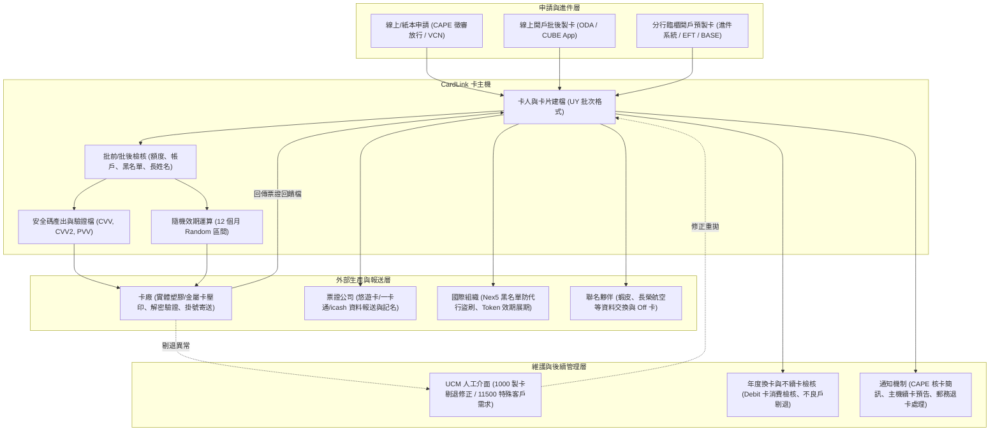

# 教育訓練知識筆記：製卡系統運作與卡片生命週期管理

---

## 1. 本次課程摘要

* **課程主題**：核心製卡系統（CardLink 主機）架構、周邊系統介接與卡片生命週期管理
* **授課講師**：佩宜
* **主要受眾**：新進 IT 人員 / 相關業務維護人員
* **課程核心目標**：
  全面梳理銀行端從客戶申請進件、主機核心建檔與檢核、卡廠實體製卡與加密壓碼、票證公司與國際組織資料報送，到卡片後續換卡、續卡、額度調整及行動支付 Token 同步之完整端到端（End-to-End）運作架構與業務規則。

---

## 2. 知識架構

本課程之知識體系依據「資料流向與生命週期」可分為五大層次：



---

## 3. 核心概念

### (1) CardLink 卡主機與 UY 異動格式
* **是什麼**：CardLink 是銀行卡片業務的核心主機系統（IBM 全球架構產品）。「UY」是主機用以批次新增、更新卡人與卡片各項欄位的標準資料格式。
* **為什麼存在**：主機需以標準化、結構化之電文介面接受來自前台進件、消審或外圍系統的大量異動請求。
* **如何運作**：
  * **UY 格式結構**：`ORG`（機構別，如國泰世華為 013）+ `TYPE`（如 000）+ `Key`（卡人為身分證轉成之 16 碼 ID；卡片則為 16 碼卡號）+ `異動日期時間` + `新增/調整代號` + `欄位代號`（如 Email、帳單結帳週期 Cycle 等）+ `異動資料值`。
  * **建檔門檻**：全新戶建置卡人資料時，必須完整送齊 20 多個必填 UY 欄位，主機才會成功建立卡人檔；若僅進行資料調整，則依 Key 值指定特定欄位代號進行覆蓋。

### (2) VCN (Virtual Card Number / 虛擬卡號即時發卡)
* **是什麼**：既有客戶線上申辦信用卡通過徵審後，在實體卡尚未製發前，數分鐘內即在系統產出虛擬卡號資訊。
* **機制與特色**：
  * 客戶可於 CUBE App 查詢卡號並完成開卡，立即綁定行動支付（如 Apple Pay）或進行線上網購與繳費。
  * 營業日夜間批次時，主機仍會將該資料與日常資料合併產出製卡檔，由卡廠印製實體卡寄送。
  * **防詐安全機制**：為防範手機遭盜用或冒名變更號碼辦卡，設有 24 小時限制作業；若客戶於實體卡寄出前反悔不要卡片，卡作部需人工在主機「下扣（Hold）」阻止實體卡片流出。
* **Combo 卡的連帶作廢風險**：若申辦 CUBE Combo 卡走 VCN，因實體卡面須壓印存款帳號，若後續檢核發現該存款帳號無效、遭凍結或有不良紀錄，將導致**整張卡片（包含信用卡與 Combo 金融功能）全面失效作廢**，無法僅停用金融端而保留信用端。

### (3) 分行預製卡與磁條第三軌 (Track 3 / TRACE)
* **是什麼**：分行臨櫃開戶時現場直接核發給客戶的簽帳金融卡（Debit 卡），卡片已由卡廠預先製作完成存於分行金庫。
* **如何運作**：
  * 分行庫存不足時，於「進件系統」下單申請補足特定金融卡商品數量。
  * 「進件系統」與「EFT / BASE」系統預先生成無人持有的「空白帳號」與「卡號」，交由卡廠批次製成現成卡片入庫。
  * 客戶臨櫃申辦時領取預製卡，系統於次日或夜間批次將該卡號正式綁定回復至該客戶帳戶名下。
* **磁條第三軌的作用**：簽帳金融卡與 Combo 卡均寫入磁條第三軌資料。當卡片插入 ATM 時，ATM 係讀取第三軌的電文字群辨識該卡片所屬帳號與身分，持卡人再行輸入晶片密碼完成身分驗證。

### (4) 安全碼機制 (CVV / CVV2 / PVV) 與抽樣驗證
* **安全碼層級**：
  * **外顯安全碼 (CVV2)**：印於卡片背面簽名欄旁（末三碼），供一般無卡交易（Card-Not-Present）驗證。
  * **內嵌安全碼 (CVV / PVV 等)**：直接燒錄壓印於卡片晶片與磁條內，肉眼無法看見，供實體刷卡授權驗證。
* **製卡防護與抽樣驗證檔**：
  * 卡主機產出資料送交 CAPE 轉送卡廠時，為避免傳輸途中遭攔截竊取，大部分資料均經過遮罩或偽造加密。
  * 為確保卡廠端解密還原邏輯正確無誤，主機會在每批資料（例如一千筆）中隨機提供 10~20 筆真實金鑰作為「驗證檔」。卡廠以此驗證解碼程序是否一致，避免全批卡片因解密錯誤而製成無法刷卡的廢卡。

### (5) 卡片效期隨機演算機制 (Random 區間)
* **機制**：卡片效期雖然常規為 5 年或 7 年，但並非固定計算為「當前月份 + 60 個月」：
  * **5 年期卡片**：於 49 至 60 個月（共 12 個月）區間內採隨機（Random）挑選到期年月。
  * **7 年期卡片**：於 73 至 84 個月（共 12 個月）區間內採隨機（Random）挑選到期年月。
* **為什麼存在**：若效期固定，有心人士一旦取得卡號，只需猜測卡片後三碼（CVV2）；透過將到期月份隨機化，大幅增加外部暴力破解（Brute Force）的排列組合難度。續卡時則依照原有效期間距展期，不開放隨意指定。

### (6) 國際組織 Nex5 報送與代行授權 (Stand-in) 防線
* **是什麼**：卡廠實體卡印製完成後、客戶正式開卡前，主機向國際組織報送「Nex5」電文，將該卡註記為「未開卡黑名單」。
* **為什麼存在**：當發卡行主機因系統維護暫時中斷與國際組織連線時，跨行交易會轉入國際組織之「代行授權（Stand-in Processing）」。代行授權端無法即時得知銀行端該卡是否已開卡；若實體卡於郵寄途中遭人截留盜刷，Nex5 黑名單可確保國際組織代行端直接拒絕交易，防杜鉅額盜刷爭議。客戶收到卡片正常開卡後，系統始解除該註記。

### (7) 行動支付 Token 批次展期與夜間維護挑戰
* **是什麼**：持卡人將實體卡綁定 Apple Pay、Google Pay 等行動支付時，國際組織所核發之虛擬代碼（Token）。
* **維護機制**：實體卡因掛失補發、年度到期續卡而換發新卡時，卡片效期隨之改變。卡主機必須於夜間批次發送交易通知國際組織更新該 Token 效期，持卡人方可無縫繼續感應消費。
* **運作時限瓶頸**：
  * 銀行授權系統在營業日夜間有兩個固定維護時段，會強制切斷與國際組織之連線。
  * 連線切斷期間，Token 更新交易完全無法發送。
  * **實務挑戰**：2023 年好市多（Costco）與 SOGO 聯名卡合約終止引發大規模轉卡換卡潮，這批巨量卡片在隔年陸續進入到期續卡循環，導致夜間 Token 更新批次筆數呈爆發性增長，面臨在授權系統切斷連線前「跑不完批次」的嚴重時限與系統效能挑戰。

### (8) 票證公司庫存與記名報送規範
* **PID 庫存管理**：票證公司（悠遊卡、一卡通、icash）整捲配發外顯票證卡號（PID）庫存（如一桶 20 萬筆）予卡作部；卡作部用罄前切換下一桶並設定系統。
* **記名與個資報送**：卡廠製卡完成回傳卡號與 PID 對照後，銀行主機必須將持卡人個資、卡片外顯資料及晶片資料報送票證公司。若未報送或遭到剔退未及時補正，票證端無法識別此卡，持卡人搭乘大眾捷運/公車時將無法使用自動加值，甚至會被讀卡機判定為偽卡或黑名單。
* **法規記名歷史演進**：
  * 民國 102~103 年上半年起，金管會全面禁止發行無記名悠遊聯名卡（因無記名卡遺失無法退還卡內餘額）。
  * 民國 110 年起，既有無記名悠遊卡補發亦不再核發無記名卡，一律強制轉為記名卡或改發不具票證功能之一般信用卡。一卡通與愛金卡自始即為記名卡。

---

## 4. 重要流程

### 流程一：線上信用卡 / Debit 卡一般申辦與製卡流程

```
客戶提出申請 (線上 / 紙本)
  ↓
CAPE 系統徵審核准放行
  ↓
拋送資料至 CardLink 主機建檔 (卡人 / 卡片 UY 資料)
  ↓
主機執行批前 / 批後檢核 (信用紀錄、名額、額度、存摺帳號狀態)
  ↓
主機產出製卡檔與壓碼加密資料 (內含抽樣解密驗證檔)
  ↓
交由卡廠製作實體卡片 (壓印姓名、長姓名處理、燒錄晶片與磁條)
  ↓
卡廠掛號郵寄卡片予客戶；同步回傳票證回饋檔
  ↓
主機報送票證公司 (持卡人資料與晶片資料記名)
  ↓
主機報送 Nex5 給國際組織 (註記未開卡黑名單防代行盜刷)
  ↓
客戶收到實體卡完成開卡 (解除 Nex5 黑名單，恢復正常交易)
```

### 流程二：VCN (即時發卡) 處理流程

```
既有卡友於線上申請指定卡別
  ↓
CAPE 於數分鐘內快速審核通過
  ↓
即時產生虛擬卡號資訊 (VCN)
  ↓
客戶於 CUBE App 查詢卡號並完成線上開卡 (可立即綁定行動支付刷卡)
  ↓
營業日夜間批次整併進件資料拋送 CardLink 主機
  ↓
主機檢核存款帳號 (若為 Combo 卡且帳號異常，整張卡註銷廢卡)
  ↓
主機產出製卡檔交卡廠印製實體卡片並寄出
  ↓
客戶收到實體卡 (若客戶反悔不開實體卡，由卡作部在主機進行下扣處理)
```

### 流程三：分行臨櫃簽帳金融卡 (預製卡) 申領流程

```
分行庫存預警 (簽帳金融卡安全存量不足)
  ↓
分行於進件系統下單提報商品需求數量
  ↓
進件系統與 EFT / BASE 生成未有人使用的空帳號與空卡號
  ↓
卡廠印製預製卡入庫 (寫入磁條第三軌 Track 3 TRACE 資料)
  ↓
客戶臨櫃開戶，分行行員現場核發預製卡
  ↓
當日夜間批次將該預製卡卡號綁定回復至該客戶名下帳戶
```

### 流程四：票證報送與製卡剔退補正流程 (UCM 1000)

```
卡廠製卡完畢，回傳卡號與 PID 對照檔
  ↓
主機將持卡人資料與晶片資料報送票證公司 (悠遊卡 / 一卡通 / icash)
  ↓
若資料齊全無誤 → 票證公司建檔生效，開通大眾運輸自動加值
  ↓ (若資料檢核有誤遭票證公司剔退)
產生製卡剔退紀錄
  ↓
卡作部於郵寄運送期間 (約 2~3 天內) 登入 UCM 功能 1000 畫面進行人工補正
  ↓
修正後重新拋入 CardLink 主機進行單位調整與補送
  ↓
若未及時補送成功 → 卡片被票證端列為黑名單，客戶將無法感應使用
```

---

## 5. 系統／角色關係

| 系統／角色名稱 | 核心職責 | 互動系統與資料流向 |
|---|---|---|
| **CAPE** | 信用卡徵審核心系統，負責線上/紙本申請之徵信審核、財力驗證、人工小審放行，以及 VCN 即時核發。 | 向主機拋送核准之進件檔；接收主機核發結果並發送審核相關簡訊（C56、C58）。 |
| **CardLink (卡主機)** | 銀行卡片核心後台（IBM 架構），統籌卡人、卡片帳務、額度控管、批次檢核、製卡檔壓碼及資料異動（UY）。 | 接收 CAPE、ODA 進件資料；產出製卡檔至卡廠；對外報送票證公司與國際組織；與 EFT/BASE 驗證帳戶。 |
| **ODA 系統** | 線上開戶與簽帳金融卡申辦系統，支援全新戶未登錄狀態下開立存款帳戶與批後製卡。 | 審核完成後，將開戶及 Debit 卡申請資料拋入卡主機進行批後製卡。 |
| **EFT / BASE** | 分行臨櫃帳務與金融卡連線核心系統，管理存款帳號狀態與磁條第三軌規格。 | 配合進件系統生成預製卡空帳號；提供卡主機檢核 Combo 卡與 Debit 卡之存款帳號合法性。 |
| **卡作部 / UCM** | 卡片作業維護單位與卡林克前端維護介面（User Control Module）。 | 透過 UCM `1000` 處理製卡剔退人工補正；透過 `11500` 處理客戶特殊指定作業；維護原住民長姓名。 |
| **卡廠 (製卡商)** | 外部實體卡片製造商，負責壓印實體卡、金屬卡洗切、晶片燒錄與掛號寄送。 | 接收主機加密製卡檔；利用抽樣驗證檔檢驗解碼邏輯；製卡完成回傳卡片資料與掛號條碼予郵務系統。 |
| **票證公司** | 悠遊卡、一卡通、愛金卡（icash）公司，提供大眾運輸感應與票證電子支付服務。 | 提供 PID 庫存桶給卡作部；接收主機之卡人與晶片報送檔；回傳回饋檔通知剔退名單。 |
| **國際組織** | Visa、Mastercard、JCB 等國際清算機構。 | 接收 Nex5 未開卡黑名單以防代行盜刷；接收主機 Token 更新交易以展期行動支付。 |
| **聯名夥伴** | 蝦皮、長榮航空、台塑等聯名合作企業。 | 透過卡人二檔交換聯名會員資訊；卡片核可、失效或停卡時由主機發送狀態同步通知（Off 卡）。 |

---

## 6. 關鍵名詞

| 名詞 | 英文／縮寫 | 說明 |
|---|---|---|
| **虛擬卡號** | VCN (Virtual Card Number) | 信用卡徵審核准後立即產出的虛擬卡號，無須等待實體卡即可開卡並綁定行動支付消費。 |
| **主機資料異動格式** | UY | CardLink 主機記錄與更新卡人/卡片特定欄位屬性的批次標準格式。 |
| **卡林克使用者控制模組** | UCM (User Control Module) | 卡主機的前端操作介面，提供卡作部行員進行製卡剔退維護（功能 1000）與特殊作業（功能 11500）。 |
| **磁條第三軌** | Track 3 / TRACE | 簽帳金融卡與 Combo 卡背面磁條之特定資料軌道，供 ATM 辨識卡片身分、帳號與連線資訊。 |
| **票證識別碼** | PID | 票證公司（悠遊卡/一卡通/icash）配發之實體票證外顯卡號識別碼。 |
| **未開卡名單報送** | Nex5 | 向國際組織通報實體卡尚未開卡的黑名單電文，避免銀行維護期間遭代行授權冒刷。 |
| **代碼化卡號** | Token | 行動支付（如 Apple Pay）使用之虛擬代碼，實體卡效期異動時須同步展期。 |
| **代行授權** | Stand-in Processing | 發卡行主機斷線或維護時，由國際組織依特定風險規則暫時代理發卡行核准交易之機制。 |
| **卡片安全檢驗碼** | CVV / CVV2 / PVV | 信用卡安全檢核碼。CVV2 為卡背外顯三碼；CVV 與 PVV 為晶片/磁條內之加密檢核參數。 |
| **預製卡** | Pre-issued Card | 分行預先印製備妥之簽帳金融卡，開戶時現場直接核發，帳號與卡號後續批次綁定。 |
| **批後製卡** | Post-issuance Card | 客戶於線上完成開戶申請後，主機產檔送卡廠印製，數日後再郵寄送達之製卡模式。 |
| **複合卡** | Combo Card | 結合「信用卡」與「晶片金融卡（提款轉帳）」功能於同一張晶片與卡體的複合金融卡。 |
| **卡人二檔** | Cardholder Secondary File | 主機中用以存放持卡人聯名卡會員資料（如長榮哩程會員號）之延伸資料檔。 |

---

## 7. 重要概念比較

### 比較一：卡片發行申辦型態比較
| 比較項目 | VCN (即時發卡) | 預製卡 (分行臨櫃) | 批後製卡 (線上申辦) |
|---|---|---|---|
| **適用對象** | 既有信用卡戶 | 臨櫃開立存款戶之客戶 | 線上全新開戶申辦 Debit 卡或新申辦信用卡 |
| **發卡時間** | 數分鐘內線上取得卡號資訊 | 臨櫃辦理完畢現場立即取卡 | 線上申請後，約需數個工作天郵寄送達 |
| **實體卡狀態** | 初始無實體卡，夜間批次再送卡廠補製 | 卡片早已預先製妥存放於分行金庫 | 審核完成後始通知卡廠製卡 |
| **帳號/卡號綁定** | 申請時即由主機配賦卡號 | 先有空白帳卡號，核發後夜間批次綁定戶名 | 審核通過後由主機配賦並產製實體卡 |

### 比較二：實體塑膠卡 vs. 頂級金屬卡
| 比較項目 | 一般塑膠卡 | 頂級金屬卡 (如長榮金屬卡) |
|---|---|---|
| **卡體材質** | PVC 塑膠複合材質，內埋感應線圈 | 實心金屬精密加工材質，重量極沉 |
| **票證功能支援** | **支援**（悠遊卡、一卡通、icash 感應線圈可正常作動） | **無法支援**（金屬材質會完全屏蔽 RFID 感應訊號） |
| **補發手續費** | 掛失補發一般收取 200 元（VIP 免收） | 補發費用高達 3,000 ~ 5,000 元（因成本高且包裝精緻） |
| **發卡定位** | 大眾普及型卡片 | 極高端尊榮客群專屬，象徵身分地位鑑別 |

### 比較三：外顯安全碼 vs. 內嵌安全碼
| 比較項目 | 外顯安全碼 (CVV2) | 內嵌安全碼 (CVV / PVV) |
|---|---|---|
| **物理位置** | 印刷於卡片背面簽名欄旁（末三碼） | 燒錄壓碼於晶片內部與磁條第二/三軌中 |
| **可見性** | 肉眼直接可見 | 肉眼無法看見，須透過讀卡設備讀取 |
| **主要用途** | 線上網購、電話語音等無卡交易（CNP）身分驗證 | 實體刷卡機（POS）、ATM 插卡/感應交易時之密碼運算驗證 |
| **主機產檔機制** | 隨效期演算生成，印於實體卡面 | 主機加密後傳送卡廠，附帶少量驗證檔檢驗解密邏輯 |

### 比較四：電子票證業者規範比較
| 比較項目 | 悠遊卡 (EasyCard) | 一卡通 (iPASS) | 愛金卡 (icash) |
|---|---|---|---|
| **記名制度歷史** | 早期曾有「無記名」卡；102 年起禁發，110 年起全面停止無記名補發 | 自始發行即強制「全面記名」 | 自始發行即強制「全面記名」 |
| **異常退卡處理** | 記名卡遺失可退還儲值金；早期無記名卡遺失無法退還 | 遺失掛失後儲值金由票證公司退還 | 遺失掛失後儲值金由票證公司退還 |
| **報送資料內容** | 持卡人姓名、身分證字號、卡號、晶片資料與效期 | 持卡人基本個資、卡號與晶片資料 | 持卡人基本個資、卡號與晶片資料 |

### 比較五：卡人額度 vs. 卡片額度
| 比較項目 | 卡人額度 (Cardholder Level) | 卡片額度 (Card Level) |
|---|---|---|
| **管控本質** | 該持卡人在銀行體系擁有的總信用歸戶上限 | 單一張特定實體卡片所分配的信用額度上限 |
| **舊戶加辦新卡** | CAPE 不一定重新給予新額度，由主機依既有卡人額度帶入 | 卡片額度不得超出持卡人既有之卡人額度 |
| **額度調降連動** | 若主動要求調降卡片額度，主機之卡人額度將**同步被調降** | 調降單卡額度時不可保留過高之卡人額度，防範風險破口 |
| **額度調升連動** | 正卡人調升額度時，主機會發送通知書告知名下所有附卡人 | 附卡共享正卡額度，隨正卡調升而受影響 |

---

## 8. 講師案例

### 案例一：CUBE Combo 申辦 VCN 卻因存款帳號異常導致「整卡報廢」
* **情境**：客戶透過線上申辦具備金融提款與信用功能的 CUBE Combo 卡，並選擇 VCN 即時核卡。客戶立即在 CUBE App 取得虛擬卡號綁定行動支付刷卡消費。
* **問題發生**：當夜間批次主機與 EFT/BASE 系統檢核其連結之存款帳戶時，發現該帳戶存在警示、凍結或檢核不過等不良紀錄。
* **處置結果**：由於實體 Combo 卡面必須雷射壓印該存款帳號，無法只單獨作廢金融提款功能，因此系統強制判定「整張卡片（含信用卡）直接失效作廢」，發送簡訊通知客戶並停用 VCN，實體卡亦不再印製。

### 案例二：好市多 (Costco) 與 SOGO 換卡潮引發的 Token 展期效能危機
* **情境**：國泰世華於 2023 年終止好市多聯名卡與遠東 SOGO 聯名卡合約，短時間內轉發了數百萬張 CUBE 信用卡。
* **問題發生**：這批巨量卡片在次年陸續進入換卡與效期展期循環。每當卡片續卡換發，主機必須向國際組織發送 Token 更新交易以展期行動支付。然而，授權系統在營業日夜間有兩次固定切斷國際組織連線的維護窗口。
* **維護瓶頸**：在非斷線的有限時段內，排隊等待送出的 Token 交易量過大，從 8 月起開始出現批次在維護切斷前「跑不完」的險境，成為維護團隊極大的效能衝擊點。

### 案例三：原住民長姓名系統因應
* **情境**：配合政府保障原住民族文化政策，持卡人得以傳統羅馬拼音或羅列之族名長姓名開戶辦卡。
* **處置作為**：政府規範上限可達 200 字，銀行主機 UCM 介面與資料庫欄位彈性預留 2 至 50 個字元的長姓名空間。所有紙本通知函、電子帳單與對外發信，均嚴格遵照客戶登記之完整長姓名全名印製，避免字元截斷引發爭議。

### 案例四：防範運送途中盜刷之 Nex5 與代行機制
* **情境**：實體塑膠卡印製完成後需透過郵局掛號寄送客戶，運送過程耗時 2~3 天。若途中郵件遭竊取，有心人士企圖於商店盜刷。
* **處置作為**：若遇銀行深夜主機維護，刷卡機離線走國際組織「代行授權（Stand-in）」，代行主機若無資料可能放行數十萬甚至百萬元交易。主機於卡片出廠時立即向國際組織通報 Nex5 黑名單，代行系統比對為未開卡卡片，一律拒絕授權，杜絕運送途中的冒刷爭議。

### 案例五：蝦皮聯名卡合約續約卡面強制更新
* **情境**：蝦皮聯名卡合約期滿重簽續約，合作方要求必須推出全面更新之專屬新卡面（如 A 卡面升級至 D 卡面）。
* **處置作為**：主機設定卡面轉換規則（ABC 轉 D 卡面），在續卡與補發時自動帶入全新外觀代碼交卡廠印製，兼顧客戶新鮮感與合約商務規範；若該卡片失效停卡，亦主動交換資料通知蝦皮將會員合作註銷（Off 卡）。

---

## 9. 講師特別提醒

1. **UCM 1000 剔退補正有嚴格時效性**：
   卡廠製卡後郵寄約需 2~3 天，若票證報送遭剔退，卡作部必須在這 2~3 天內利用 UCM `1000` 介面補正並重拋。若超過時效客戶收到卡片，捷運公車感應將直接判定為黑名單或偽卡，引發嚴重客訴。
2. **金屬卡物理限制不可違反**：
   金屬材質本身會屏蔽 RFID 高頻無線電磁波，**絕對無法製作具備電子票證（悠遊卡/一卡通）感應功能之金屬卡**，若業務端提出此類商品企劃應直接予以澄清。
3. **安全金鑰絕不可全明文傳輸**：
   主機傳送卡廠的壓碼檔案絕不能包含明文密碼，全部以假值掩飾，僅抽樣 10~20 筆作為解密演算法驗證，維護金融製卡資安合規。
4. **效期隨機演算防護不可取消**：
   5 年（49~60 個月）與 7 年（73~84 個月）隨機亂數（Random）效期是防禦外部黑客暴力枚舉 CVV2 的關鍵防線，不可任由人工干預或隨意指定固定效期。
5. **學生身分額度法定上限嚴格控管**：
   學生卡額度依法上限為 2 萬元。若特殊核准超過 2 萬元，系統將強制納入消審監控名單進行繳款追蹤，且後續調額難度極高，切勿隨意放行調額。
6. **簽帳金融卡（Debit 卡）不續卡機制**：
   持卡人若長期未使用 Debit 卡，銀行於到期前會發信通知其於期限內至少完成一筆交易，若屆期仍無任何使用紀錄，系統將**直接不予續卡**以節省製卡成本。

---

## 10. Q&A

### Q1：金融卡插入 ATM 提款時，ATM 到底是用晶片感應還是磁條？第三軌的作用是什麼？
* **解答**：
  金融卡插入 ATM 時，ATM 首先透過讀取卡片背面的「磁條第三軌（Track 3 / TRACE）」電文字群，迅速辨識出這張卡片所屬的帳號、銀行別與卡片身分；確認身分後，再由持卡人於鍵盤輸入晶片密碼，晶片與核心連線完成驗證後方能執行提款或轉帳交易。感應線圈（塑膠卡內藏白線圈）則是專門用於感應刷卡消費（如感應式信用卡/票證）。

### Q2：卡主機傳給卡廠製卡時，如何確保密碼資訊在傳輸途中不被竊取駭入？
* **解答**：
  卡主機送往 CAPE 轉卡廠的製卡壓碼檔中，所有安全密碼均已進行偽造或假值遮罩，運輸過程中即使遭攔截也無法取得真實密碼。但為了避免卡廠解密邏輯出錯而做出一整批無法刷卡的廢卡，主機會隨機挑選 10~20 筆提供真實解密結果作為「驗證檔」，卡廠僅以這幾筆測試解密運算結果是否吻合，吻合即代表全批邏輯正確。

### Q3：客戶申辦卡片流程中發送的各類簡訊，是由主機發送還是 CAPE 發送？
* **解答**：
  依業務階段與職責劃分：
  * **CAPE 發送**：偏向核卡與徵審進度通知（如 C56、C58 核卡通過、補件核可通知）。
  * **卡主機發送**：偏向卡片生命週期之預告通知（如次月中下旬發送續卡預告簡訊，通知客戶於次月 1 日前決定是否變更地址或取消續卡）。
  * **郵務系統發送**：偏向卡廠掛號寄出、退卡收容後的通知（如退卡招領簡訊，若二次通知仍未領取則由主機下停卡銷毀）。

### Q4：若簡訊或通知信函需要帶入客製化客戶姓名，主機端是如何處理變數的？
* **解答**：
  簡訊或 Email 系統均有預設之制式模板與變數代號（如 `變數一` 為姓名/稱謂、`變數二` 為卡號末四碼）。主機僅依格式將指定欄位的值傳遞過去填入模板對應位置。基於個人資料保護法考量，實務上通常盡量減少於通知簡訊中暴露過多敏感明文個資。

---

## 11. 尚待釐清

依據本次授課內容，下列項目講師於課堂中表示「未完全確定」、「早期歷史背景不詳」或「作業細節尚未拍板」，留待後續確認：

1. **CUBE Combo 停辦後既有卡友之換卡政策**：
   目前線上進件已全面停止新申辦 CUBE Combo 卡，但針對既有持有 CUBE Combo 卡之客戶於卡片到期時，是否維持原樣換發 Combo 卡，抑或強制拆分為一般 CUBE 信用卡搭配一張獨立 Debit 卡？目前專案整體規劃細節尚未正式出爐。
2. **早期「降地郵檢」業務緣由**：
   系統保留之早期檢核代碼「降地郵檢」（約民國八、九十年間之產物，推測為牙醫師工會聯名卡等特殊歷史遺留規格），講師表示確切業務歷史背景與命名意涵現已不可考。
3. **預借現金密碼函確切作業流程**：
   申辦過程中若勾選申請預借現金功能，系統產製並寄送預借現金密碼函之確切作業流程，講師表示該業務細節較為繁瑣且非其直接管轄，未於本次詳細展開。
4. **外圍票證對接系統專有名稱**：
   卡主機產出實體卡號與票證 PID 對照之「買品檔」，係拋送予行內外圍票證相關系統（對接同仁為惠如），該外圍系統之正式系統名稱尚待進一步查證。
5. **早期「緊急製卡」之現行主責單位狀況**：
   早期針對客戶急用之「緊急製卡」流程需跨單位（卡主機、EFT/BASE、CAPE、進件系統）即時協同啟動，自 VCN 上線後緊急製卡需求已大幅萎縮，目前線上維護人員均無實際執行經驗，現行由哪個具體單位發起啟動待確認。

---

## 12. 補充知識

> [!NOTE]
> 以下內容並非原始逐字稿內容，而是補充說明，旨在協助學員更深入理解相關金融與資安標準。

1. **EMV 晶片與磁條規格 (磁軌架構)**：
   * **Track 1 (第一軌)**：儲存持卡人姓名、卡號、效期等（早年航空訂位系統常用），字元長度約 79 個字元。
   * **Track 2 (第二軌)**：儲存卡號、到期年月、服務代碼（Service Code）與 CVV，主要供一般實體店家刷卡機（POS）交易。
   * **Track 3 (第三軌)**：由發卡銀行自訂規格之讀寫軌道，台灣金融機構主要用來記錄帳號、動態交易計數器與密碼驗證電文，供自動櫃員機（ATM）提款轉帳辨識使用。
2. **代行授權 (Stand-in Processing, STIP) 機制**：
   當發卡銀行授權主機因歲修、網路中斷或負載過高無法回應時，國際組織（Visa / Mastercard）的 STIP 系統會代發卡行根據預先協議之限額（如每筆不超過 3,000 元、單日累計限額）進行風險審查並代行核准交易。因此，在發卡行尚未確認卡片開卡前，必須透過 Nex5 等註記機制強制阻斷代行放行，防止遭截留盜刷。
3. **原住民身分證長姓名開戶規範**：
   依據內政部《姓名條例》及金管會相關金融法規函示，原住民族得以傳統名字之羅馬拼音或漢人姓名並列登記於身分證件。各金融機構之核心帳務與信用卡系統必須擴增字元長度支援（長姓名欄位規格），並於所有對外寄送之開戶通知函、卡片信封與帳單完整呈現，不得任意截斷。
