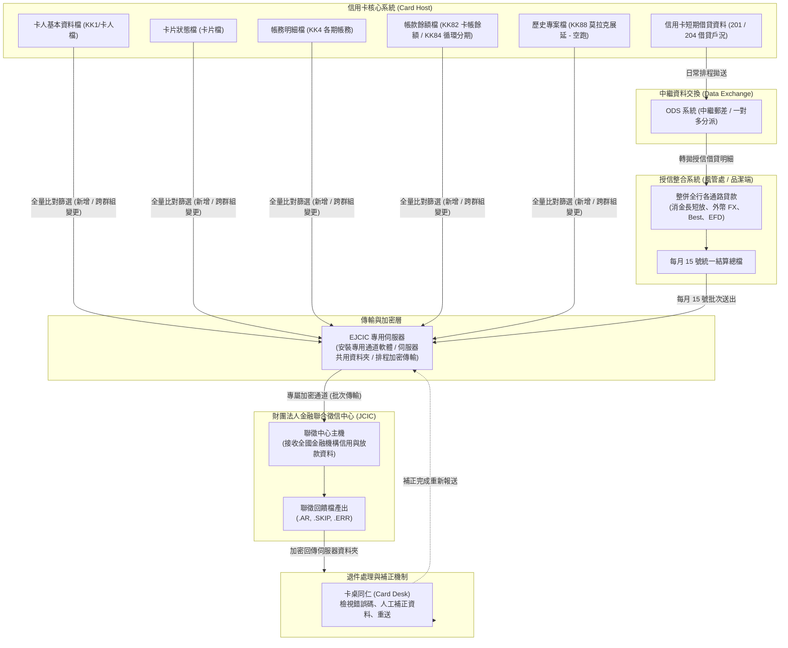

# 教育訓練知識筆記：信用卡與授信 JCIC 聯徵資料報送機制

> **課程講師**：佩宜  
> **整理日期**：2026-10-30  
> **適用對象**：信用卡處、授信風控、主機維運及新進同仁  
> **文件版本**：v1.0 (教育傳承版)  

---

## 1. 本次課程摘要

本課程由佩宜主講，系統性解說本行信用卡及授信業務向**「財團法人金融聯合徵信中心」（JCIC，以下簡稱聯徵中心）**報送與調閱資料的整體架構、檔案代碼、報送路徑、全量比對篩選邏輯、退件補正流程，以及銀行內部關鍵資料控管原則。

### 核心要點歸納：
1. **雙軌報送路徑**：
   - **信用卡純卡端資料**（卡人基本資料、卡片狀態、帳務帳款）：由信用卡主機直接產出，經由專用加密伺服器（EJCIC Server）直送聯徵中心。
   - **授信借貸類資料**（信用卡短期放款、預借現金、分期借貸等 201/204 檔）：由信用卡端透過中繼資料庫（ODS）拋送至風管處「授信整合系統」（品潔維護），整併全行各通路（含消金放款、外幣 FX、Best 等）之短期、中期、長期貸款資料後，於每月中（固定 15 號結算排程）統一彙總報送聯徵中心。
2. **全量比對篩選原則**：
   - 卡人檔與卡片檔每日均採「全量比對」（Full Comparison），首度出現者報新增（New），內容異動者報變更（Change）。
   - **卡人比對**條件較寬鬆：排除純 Debit 卡客戶，只要名下持有信用卡有效活卡，任何欄位異動（如電話、地址、Email）即觸發變更報送。
   - **卡片比對**條件較嚴謹：僅針對特定重要欄位變更報送；停用代碼（Block Code）採分群控管，**唯有跨群組異動才觸發報送**，同群組內異動則保留（Keep）不報送。
3. **銀行資安與資料「不可真正刪除」原則**：
   - 基於金管會監理、洗錢防制法及司法/法院調閱歷程要求，銀行資料庫絕不執行實體「物理刪除」（Physical Delete），客戶銷戶或停用僅標記為「邏輯失效」（Logical Invalidation）。
   - 報送聯徵中心若需真正刪除記錄，必須專簽正式公文至聯徵中心高層人工辦理；實務上嚴禁隨意向聯徵發動刪除代碼。
4. **聯徵回饋檔（Feedback File）檢核與卡桌補正**：
   - 報送後聯徵中心回傳回饋檔（如 `.AR`、`.SKIP`、`.ERR` 等），若有欄位被剔除退件（Kick/Reject），由**卡桌（Card Desk）**人員人工比對原因、逐筆補正資料後重新報送。
   - 若未及時補正重送，將遭內部稽核列管，且必須出具正式說明公文。

---

## 2. 知識架構



---

## 3. 核心概念

### 1. 聯徵資料報送與信用調閱（Credit Reporting & Inquiry）
- **是什麼**：各金融機構將客戶之信用卡持有狀況、授信放款餘額、繳款歷程與違約紀錄，依主管機關規定規格每日或定時拋送給聯徵中心；同時向聯徵中心調閱客戶在全國各金融機構之信用總覽紀錄。
- **為什麼存在**：建立跨機構之個人信用資料庫，防範過度融資與惡意倒帳，維護國家整體金融穩定。
- **如何運作**：
  - **雙向收費機制**：銀行報送資料給聯徵需遵循規範；銀行向聯徵調閱徵信報告時，聯徵中心按筆計費。
  - **調閱留痕與期中覆審**：客戶新辦業務時銀行會進行「新業務查詢」；銀行亦會定期對既有客戶進行「期中信用覆審」（中間管理），掌握客戶在外部銀行的風險狀況。每一次調閱均會留下查詢紀錄（常有客戶因看到「國泰世華定期調閱」而提出客訴，審查與客服人員需妥善釋疑）。
  - **徵信應用**：聯徵報告會提供給審查單位（小沈/審查科）及信用評分決策引擎（如 Trader / 評分模型）計算風險分數區間，作為核准額度、升降額或調整利率之依據。
  - **前置協商機制**：當客戶繳款能力惡化、無力償還帳單時，債權管理處（債管）會依規定啟動債務協商機制，提供低利分期還款方案。

---

### 2. 信用卡檔案體系（KK 系列檔）
- **是什麼**：信用卡核心主機依聯徵規範產出之標準信用卡報送檔案體系。
- **主要檔案代碼與功能**：
  - `KK1` / 卡人基本資料檔：客戶基本身分證號、姓名、聯絡地址、電話、Email 等。
  - `KK4`：客戶各期帳戶帳單明細、應繳金額、實繳金額及繳款狀態。
  - `KK82`：每月帳款餘額檔（包含各卡未繳餘額、分期付款後之剩餘未到期餘額等）。
  - `KK84`：循環信用餘額與分期付款明細資料。
  - `KK88`：莫拉克風災展延專案專用檔（歷史遺留檔案，目前系統維持空跑）。

---

### 3. 授信放款報送體系（201 / 204 / 207 檔）
- **是什麼**：持卡人利用信用卡額度所進行之借貸行為（如預借現金、卡友短期貸款、分期週轉金等），在金融分類上屬於「授信放款」範疇，而非純消費簽帳。
- **主要檔案代碼與分工**：
  - `201 檔`：授信帳戶餘額、額度狀況與放款戶況資料。
  - `204 檔`：借貸人基本資料與信用卡放款明細資料。
  - `207 檔`：帳務主機端短期借貸專用代碼。
- **與純卡檔案的差異**：201/204 檔不直接送往聯徵中心，而是透過 ODS 轉交至「授信整合系統」（風管處/品潔端），由該平台整併房貸、信貸、外幣放款等各通路資料後統一報送。

---

### 4. 全量比對機制（Full Comparison Engine）
- **是什麼**：主機在產出報送檔時，提取內部完整資料池（全量資料），與上一期的報送基準底檔進行逐筆逐欄對比。
- **比對邏輯**：
  - **新增（New）**：昨日不存在、今日新產生的紀錄，直接整筆送出。
  - **異動（Change）**：歷史已存在的紀錄，比對是否符合特定欄位變更觸發規則；符合者才產出變更報送檔。
  - **未變更**：完全無異動者過濾不送，節省連線傳輸頻寬與聯徵處理資源。

---

### 5. 邏輯失效 vs. 物理刪除（Logical Invalidation vs. Physical Delete）
- **核心鐵律**：**銀行內部「絕無物理刪除」機制！**
- **法理依據**：銀行受金融消費者保護法、銀行法、洗錢防制法及法院強制執行/司法調閱規範，所有帳務與客戶歷程均為重要法律證據。
- **執行方式**：客戶註銷、停卡或依個資法要求刪除資料時，系統僅將狀態標記為「失效」（Invalid），使該資料不再參與前台交易與後續常態報送，但歷史底層資料永不自資料庫清空。
- **聯徵刪除之嚴格性**：若向聯徵中心誤報「刪除代碼」，聯徵中心資料庫將被清空；若實務上確需刪除聯徵紀錄，必須專簽正式公文經由聯徵中心高層主管核准後人工處理。

---

## 4. 重要流程

### 流程一：信用卡純卡資料報送流程（直送路徑）

```
[信用卡主機核心資料]
        │
        ▼
[提取全量卡人 / 卡片 / KK帳務明細]
        │
        ▼
[執行 JCIC 規格欄位檢核] ── (若規格不合則由主機預先攔截)
        │
        ▼
[全量比對 (Full Comparison)]
   ├── 新增卡片/卡人 ──► 產出 [新增 (New) 報送檔]
   ├── 重要欄位變更/跨群組 Block Code ──► 產出 [異動 (Change) 報送檔]
   └── 無異動 / 刪除代碼 ──► [過濾不送出]
        │
        ▼
[存入 EJCIC 伺服器內部共用資料夾]
        │
        ▼
[定時排程啟動加密通道傳輸]
        │
        ▼
[直送至 JCIC 聯徵中心]
```

---

### 流程二：授信放款資料彙整報送流程（整併路徑）

```
[信用卡短期借貸放款資料 (201 / 204 / 207)]
        │
        ▼
[拋送至 ODS 系統 (資料中繼郵差)]
        │
        ▼
[ODS 轉拋至 風管處授信整合系統 (品潔維護)]
        │
        ▼
[授信整合系統彙整全行各通路資料]
   ├── 信用卡短期借貸 (201 / 204)
   ├── 個人消費信用貸款 (EFD 等)
   ├── 企金放款主機 (Best)
   └── 外幣放款 (FX) 等各通路長短期放款
        │
        ▼
[每月固定結算時程 (如每月 15 號)] ──► 產出全行授信總報送檔
        │
        ▼
[送交 EJCIC 伺服器共用資料夾]
        │
        ▼
[透過專屬加密專線拋送至 JCIC 聯徵中心]
```

---

### 流程三：聯徵回饋檔檢核與退件補正流程

```
[JCIC 接收資料並完成驗證]
        │
        ▼
[產出聯徵回饋檔 (.AR / .SKIP / .ERR 等)]
        │
        ▼
[回傳至行內 EJCIC 伺服器]
        │
        ▼
[卡桌同仁 (Card Desk) 檢視被踢退 (Kick) 清單]
        │
        ▼
[判定錯誤原因：如身分資料不符、必填欄位缺漏、格式錯誤]
        │
        ▼
[卡桌同仁於系統以人工方式進行欄位補正]
        │
        ▼
[重新排程產檔並發動二次報送]
        │
        ▼
   ┌────┴─────────────────────────────┐
   ▼                                  ▼
[補正成功，通過檢核]        [逾期未補正 / 連續失敗]
                                      │
                                      ▼
                            [觸發內部稽核管制點]
                                      │
                                      ▼
                            [由主管簽陳正式公文說明緣由]
```

---

## 5. 系統與角色關係

| 角色 / 系統名稱 | 單位屬性 | 主要執掌與在報送體系中的角色 |
|---|---|---|
| **佩宜（講師）** | 信用卡業務 / 系統維護組 | 負責信用卡資料報送邏輯維護、全量比對規則制定與經驗傳承。 |
| **卡桌（Card Desk）** | 卡片維護 / 授權維護同仁 | 負責每日/每批聯徵回饋檔（Feedback Files）的檢視；當資料被聯徵 Reject/Kick 時，負責查明原因、人工手動補齊資料並重新發動報送。 |
| **品潔（授信窗口）** | 風管處 / 授信整合系統團隊 | 維護全行「JCIC 授信整合系統」，負責接收信用卡端及全行各通路放款資料，按月彙整後統一對外報送授信資料。 |
| **審查單位（小沈/審查科）** | 徵審部 / 風險管理處 | 接收由聯徵中心回傳之客戶徵信報告與歷史紀錄，執行人工或自動化風險審查。 |
| **評分決策模組（Trader）** | 風險模型 / 決策引擎組 | 整合聯徵分數與內部往來數據，計算客戶信用評分區間，作為額度核准、分期條件與利率定價依據。 |
| **債權管理處（債管）** | 催收 / 協商作業部 | 針對信用不良或繳款困難客戶，依聯徵通報機制啟動債務協商機制，制定降息與分期還款計畫。 |
| **ODS（中繼資料庫）** | 資訊架構維運（MIS/資料科） | 充當系統之間的「資料郵差」；解決各子系統無法直連的問題，支援一對多通路之資料轉拋。 |
| **EJCIC 專用伺服器** | 資訊系統維運 / 網路資安組 | 安裝聯徵專用加密通道軟體之專屬主機，提供內部共用資料夾，具備排程定時拋檔功能；配有內部管理介面，供特定權限人員重送與檢視。 |
| **聯徵中心（JCIC）** | 外部特許機構 | 國家級個人與企業信用資料庫，負責接收各行庫通報、提供徵信調閱，並回傳格式檢核回饋檔。 |

---

## 6. 關鍵名詞定義

| 名詞 | 英文 / 代碼 | 說明 |
|---|---|---|
| **金融聯合徵信中心** | **JCIC** | 財團法人金融聯合徵信中心。我國唯一跨金融機構之信用報告集中建檔機構。 |
| **聯徵專用伺服器** | **EJCIC Server** | 銀行內部專門用於對接 JCIC 之專屬通道伺服器，安裝聯徵官方授權軟體進行端對端加密通訊。 |
| **期中信用覆審** | **Intermediate Review** | 俗稱「中間管理」或「期中覆審」。銀行定期向聯徵中心調閱既有客戶最新信用狀態，用以監控風險並動態調整信用額度。 |
| **作業資料儲存庫** | **ODS (Operational Data Store)** | 系統間中繼資料庫，負責跨系統之資料彙整、格式轉換與中繼派送（扮演「系統郵差」角色）。 |
| **控管代碼 / 停用碼** | **Block Code** | 信用卡主機上標記卡片異常、停用、偽冒控管或強制停用之代碼。JCIC 有既定分群規則。 |
| **回饋檔** | **Feedback Files** | JCIC 處理完行內報送檔後產出之檢核結果檔，常見副檔名如 `.AR`（Accept/Reject 報告）、`.SKIP`、`.ERR`。 |
| **全量比對** | **Full Comparison** | 系統每日將全部有效資料池與昨日快照進行逐筆比對，篩選出真正新增（New）與異動（Change）之資料筆數。 |
| **簽帳金融卡** | **Debit Card** | 存款帳戶連結卡片，非信用貸款性質；在卡人全量比對中，**若客戶僅持有 Debit 卡則不予納入報送**。 |
| **莫拉克專案檔** | **KK88** | 早期因應莫拉克颱風受災戶債務展延設立之報送檔案代碼。現已無實質個案，系統維持空跑。 |

---

## 7. 重要概念比較

### 比較一：卡人報送 vs. 卡片報送

| 比較維度 | 卡人資料報送（KK1 / 卡人檔） | 卡片資料報送（卡片檔） |
|---|---|---|
| **對象層級** | 客戶自然人層級（ID 戶號） | 實體/虛擬卡片層級（Card No） |
| **納入範圍** | 名下持有「信用卡有效活卡」者（排除純 Debit 卡戶） | 本行核發之各項信用卡卡片 |
| **篩選條件嚴謹度** | **較寬鬆**（採大網過濾） | **較嚴謹**（避免過度報送產生雜訊） |
| **新增（New）判定** | 昨日無有效活卡、今日首度開卡生效 | 昨日無此卡號、今日新製卡核發 |
| **變更（Change）判定** | 只要通訊地址、電話、Email 等任一欄位異動即觸發送出 | **特定觸發條件**：<br>1. 持卡人身分證號變更<br>2. 額度調高或調低<br>3. 卡片 Memo 註記變更<br>4. **Block Code 跨群組異動** |
| **同群組異動處理** | 欄位有變更即報送 | 同一群組內變動時，系統自動 Keep 住不送，維持前次狀態 |

---

### 比較二：信用卡純卡資料 vs. 授信借貸資料

| 比較維度 | 信用卡純卡資料（卡人/卡片/帳務） | 授信借貸資料（201/204/207） |
|---|---|---|
| **業務本質** | 簽帳消費、持卡身分、帳單繳款 | 融資放款、預借現金、卡友短期貸款 |
| **使用檔案** | KK1、KK4、KK82、KK84 | 201（戶況）、204（個人/卡片借貸）、207（帳務） |
| **傳輸路徑** | 信用卡主機 ──► EJCIC Server ──► JCIC | 信用卡主機 ──► ODS ──► 授信整合系統 ──► EJCIC Server ──► JCIC |
| **整併單位** | 信用卡處獨立產檔送出 | 風管處授信整合平台（品潔端）統整全行放款 |
| **報送時程** | 日常/定期批次依排程拋送 | 每月固定時程統一結算（如每月 15 號） |

---

### 比較三：物理刪除 vs. 邏輯失效

| 比較項目 | 物理刪除（Physical Delete） | 邏輯失效（Logical Invalidation） |
|---|---|---|
| **資料庫操作** | `DELETE FROM table WHERE...` 直接抹除硬碟紀錄 | `UPDATE table SET status='INVALID'...` 標記狀態 |
| **銀行內部政策** | **嚴格禁止！絕對不可存在** | **標準正規作業流程** |
| **合規與法規風險** | 若刪除將面臨金管會罰鍰、檢調調卷無門、稽核重大缺失 | 完整保留歷史軌跡，隨時可供調閱與稽核驗證 |
| **聯徵報送處理** | 嚴禁向聯徵拋送 Delete 指令；若需真刪除需專簽至聯徵高層 | 將卡片或帳戶狀態通報為停用/失效，未來不再重複報送 |

---

## 8. 講師真實案例

### 案例一：KK88 莫拉克風災專案檔空跑十餘年
- **案例背景**：十餘年前莫拉克颱風侵襲台灣，主管機關與銀行公會成立受災戶專案貸款與卡債展延救助措施，系統端配合開發了代號 `KK88` 的專屬報送檔案。
- **發展現況**：十幾年過去，災區重建完成、受災戶貸款皆已清償結案，實際上早已無任何需要展延的受災戶資料。
- **維運怪象**：由於該報送代碼深植於大型主機的批次排程中，內部無人敢輕易變動或下線該程式，導致每個月系統依然固定執行排程、產出空檔案拋送給聯徵中心，聯徵中心亦回傳空的回饋檔，形成「行內空跑、聯徵空回」長達十幾年的歷史遺留怪象。

---

### 案例二：上線指令誤植釀數百萬筆放款資料蒸發，工讀生紙本手打救災
- **案例背景**：某次重大系統改版上線作業（品潔所屬的授信端整合系統），維運人員在進行系統切換與備份還原時，誤將測試環境的清檔指令或還原指令在正式環境中執行。
- **災難後果**：正式環境中累積數年的歷史授信與貸款資料遭到大面積覆蓋清空，數百萬筆放款資料瞬間消失，現場全面炸裂。
- **搶救過程**：
  1. 所幸先前機房設備汰換升級時，舊硬體設備尚未退租還架，工程人員緊急自舊機器搶救出早期歷史底檔。
  2. 但中段數年間更新的百萬筆貸款變更資料在舊機器中並不存在，無法透過系統自動復原。
  3. 最終銀行動員全體力量，將多年來的紙本借據、傳票與合約調出，緊急聘請大量工讀生以人工鍵入（Key-in）的方式，一筆一筆手動打字回補資料庫。
- **警示意涵**：佩宜特別以此血淋淋的案例告誡同仁，在銀行內部對「刪除」指令必須抱持最高度敬畏，任何涉及備份、還原與清檔的動作均需反覆雙重覆核。

---

## 9. 講師特別提醒（重要注意事項）

1. **嚴禁在報送中觸發「刪除代碼」**：
   - 銀行系統沒有刪除機制，面對任何註銷需求，一律僅設定為「失效」。若誤報刪除給 JCIC，將導致客戶在聯徵中心的歷史信用資料斷裂，需報請聯徵高層專案公文人工修復，將產生極大稽核責任。
2. **Block Code 必須「跨群組」才報送**：
   - 卡片停用原因代碼（Block Code）有明確的群組定義（如一般停用、個人因素停用、強制停用等）。**只有在「不同群組之間跳動」時才允許報送**；若僅是同群組內的細部代碼變更，系統必須自動 Keep 住不送，否則會因頻繁報送無實質意義之狀態而遭聯徵中心關切。
3. **退件（Kick）資料必須由卡桌限期補正重送**：
   - 聯徵回饋檔中顯示退件（Kick/Reject）的資料，卡桌同仁不可置之不理。每筆退件皆有列管時效，若未及時人工補正重新報送，將觸發稽核檢核點，主管必須開立正式公文向稽核與監理單位提出專案檢討報告。
4. **期中信用覆審調閱需具備客訴應對意識**：
   - 銀行為控管既有戶風險，會定時大量向聯徵中心調閱期中覆審報告。由於所有查詢均會揭露在客戶個人的信用報告上，常引發既有客戶致電抱怨「我又沒借錢，為何國泰一直在查我？」審查與客服人員需清楚理解這是法規規範的定期中間管理，並具備標準話術安撫客戶。
5. **雙向收費的成本觀念**：
   - 聯徵中心並非免費公益平台，金融機構提供資料是法定義務，但向聯徵中心調閱個人信用報告「每一筆都要付費」。系統在設計自動調閱排程時，必須考量成本與查詢效益。

---

## 10. Q&A 互動精選

### Q1：如果客戶依據《個人資料保護法》來函主張終止授權，要求銀行將其個資「完全刪除」，銀行可以真正刪除嗎？
> **講師解答**：
> **絕對不可以。** 雖然客戶有權提出終止使用，但銀行業屬於特許金融行業，受金管會監理、洗錢防制法、商業會計法等上位法規規範，依法必須保留法定年限內的交易憑證與往來歷史，以備檢調、法院或主管機關調閱。因此實務上僅會將客戶註記為「失效/終止」，封存資料使其不再對外流通或進行行銷，但資料庫底層絕不會物理刪除。

### Q2：既然所有資料最終都要送往 JCIC，為什麼信用卡帳務和卡片資料不乾脆直接併入「品潔」那邊的授信整合系統一起送？
> **講師解答**：
> 全行大整合成單一窗口確實是未來的長遠方向。但目前存在歷史架構包袱：信用卡本身的交易量與帳務結構極其龐大且複雜，與傳統消金放款的生命週期截然不同；且過去各系統在排程介接時經常發生欄位卡住或時程延誤等摩擦，為了確保每日信用卡報送的獨立性與時效性，目前仍維持信用卡純卡直接報送、授信放款走整合平台的雙軌作業模式。

### Q3：ODS 系統在整套架構中到底扮演什麼角色？
> **講師解答**：
> 可以把 ODS（Operational Data Store）想像成系統之間的**「郵差」**。因為行內很多獨立核心系統之間基於架構安全或協定差異，無法彼此直接拉線通訊；此時信用卡系統將 201/204 借貸資料拋進 ODS，ODS 再負責轉送給授信整合平台。同時，若行內其他通路（如理財、電商貸款）未來需要這份借貸資料，也可以透過 ODS 申請取用，發揮一對多的中繼派送功能。

### Q4：收到聯徵回饋檔（.AR、.SKIP 等）之後，是哪個單位負責處理？
> **講師解答**：
> 由**「卡桌」**同仁負責處理。卡桌同仁會逐筆檢視回饋檔中的錯誤原因（例如特定必填欄位空白、格式錯誤或身分檢核失敗），在管理端以人工方式「土法煉鋼」進行查證與補正，改好之後再重新觸發報送。這項作業非常重要，若沒處理好導致逾期，會被內部稽核開單並要求出具檢討公文。

### Q5：EJCIC 伺服器的連線傳輸方式為何？一般同仁如何取得操作權限？
> **講師解答**：
> EJCIC 伺服器是由聯徵中心工程人員來行內協助配置專屬加密軟體與專用通道的伺服器，日常透過排程讀取伺服器內部共用資料夾中的檔案向外傳輸。伺服器配有一個較為傳統（古董級）的 UI 介面，供人員查看資料夾與發動手動重送。該介面權限控管極嚴，通常是由主管核准後，由維運人員直接複製（Copy）具備既有權限同仁的節點權限來配置。

---

## 11. 尚待釐清事項（依逐字稿紀錄）

1. **債權管理處（債管）協商利率與條件細節**：
   - 逐字稿中講者提及繳款不佳時債管有協商機制，可提供較低分期利率，但講者表明「比較細節的協商我沒辦法去講」，其具體申請條件與協商作業規範屬債管處範疇，需進一步查證該部門規章。
2. **KK82 檔案餘額計算之詳細公式**：
   - 針對 KK82 檔案每月的帳款餘額，講者表示「不確定它是不是分期之後的一些餘額資料，細節要再問帳務組」，確切扣減邏輯需洽詢發卡帳務組。
3. **信用卡 204 / 207 授信明細欄位規格**：
   - 關於放款借貸代碼 204 與 207 對應之貸款起訖期數、週轉性質等詳細欄位填報規則，講者表示「需要查書面規格後再講」，需調閱聯徵授信報送規格書進一步對照。
4. **ODS 系統現行維運科別名稱**：
   - 講者指出行內 MIS 與 ODS 維運部門組織架構變動頻繁、科別名稱經常更換，實際走單流程與窗口人員名單需依最新組織編制確認。

---

## 12. 補充知識

> [!NOTE]
> **以下內容並非原始逐字稿內容，而是補充說明，旨在協助同仁建立更完整的法規與聯徵技術背景。**

### 1. 聯徵中心常見官方報送檔案類別對照
聯徵中心（JCIC）官方規範之報送檔案代碼通常分為三大板塊：
- **信用卡業務相關檔（KK 類別）**：
  - `KK1`：信用卡持卡人基本資料檔（每日或異動報送）。
  - `KK2`：信用卡卡片資料檔（包含卡號、卡別、核發日、停用原因代碼）。
  - `KK4`：信用卡每期帳單及繳款資料檔（每月帳單結帳後報送，揭露應繳金額、實繳金額及繳款評等）。
  - `KK8` 系列：包含循環信用餘額檔、分期付款明細檔（揭露總分期期數、已攤還期數與未到期本金）。
- **授信放款業務相關檔（B 類別 / 200 系列）**：
  - `B01` / `201`：授信基本資料及餘額狀況報送檔（紀錄借款額度、現欠餘額、科目代碼）。
  - `B21` / `204`：放款借款人基本資料及貸款帳戶明細檔。
- **存款帳戶與電子支付相關檔**：
  - 包含電子支付帳戶身分認證、存款帳戶警示通報檔（Z 類檔案）等。

### 2. 金融法規對於「資料不可刪除」之保存年限標準
銀行之所以在實務上嚴格禁止實體刪除客戶歷史資料，核心在於多項上位金融法令的強制規定：
- **《洗錢防制法》第 8 條**：金融機構對客戶身分確認程序所得之資料，以及交易紀錄憑證，自業務關係結束或交易完成起，**至少應保存五年以上**；涉及重大洗錢嫌疑案件甚至需無限期延長保存。
- **《商業會計法》第 38 條**：各項會計憑證，除應永久保存或有關未結會計事項者外，**應於年度決算程序辦理完竣後，至少保存五年**；各項會計帳簿及財務報表，至少保存十年。
- **《個人資料保護法》第 11 條但書**：個人資料蒐集之特定目的消失或期限屆滿時，應主動或依當事人之請求刪除，**「但因執行職務或業務所必須，或經當事人書面同意者，不在此限」**。銀行基於法定監理職責與防杜金融犯罪之需要，完全符合但書規定，因此在實務上僅執行「邏輯失效」與「存取控管」，不予實體刪除。

### 3. 期中信用覆審（中間管理）的實務風控運作
- **觸發時機**：銀行風控系統通常設定每季、每半年或重大事件發生時，對全體持卡人發動批次聯徵查詢。
- **監控指標**：
  1. **聯徵信用評分（JCIC Score）**：監控客戶分數是否出現斷崖式下跌（例如由 750 分降至 500 分以下）。
  2. **外部負債增加率**：監控客戶在近期內是否在其他銀行大量申辦信貸、預借現金或被多家銀行查詢。
  3. **外部卡債延滯**：客戶若在其他行庫出現延滯（M1+），即便在本行繳款正常，亦會觸發內部預警。
- **管制措施**：期中覆審命中高風險規則之客戶，系統將自動啟動風險管控手段，包含：自動降低信用卡額度、關閉預借現金功能、調高分期審核門檻，甚至執行強制停卡（Block Code），防範客戶在本行產生呆帳損失。
