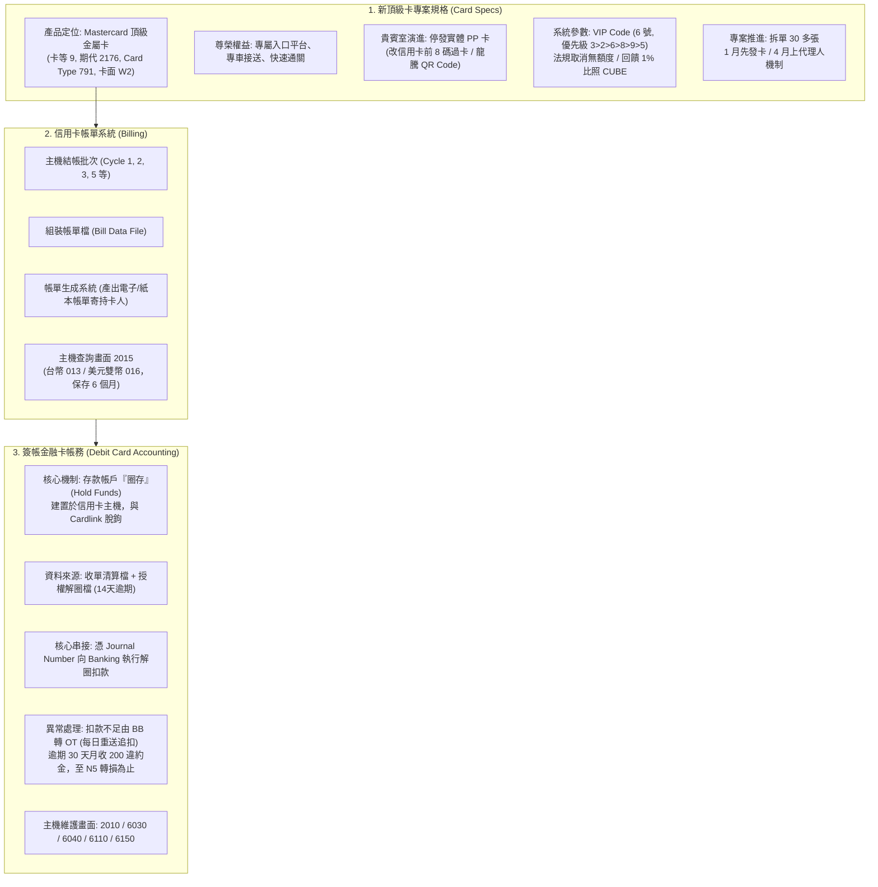
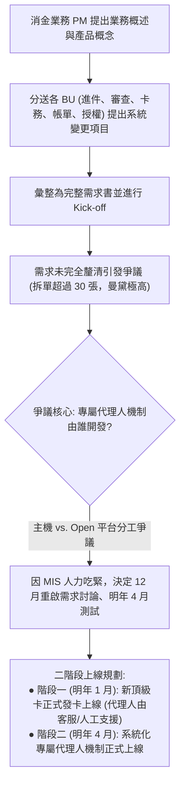
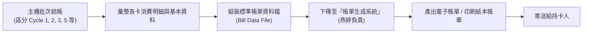
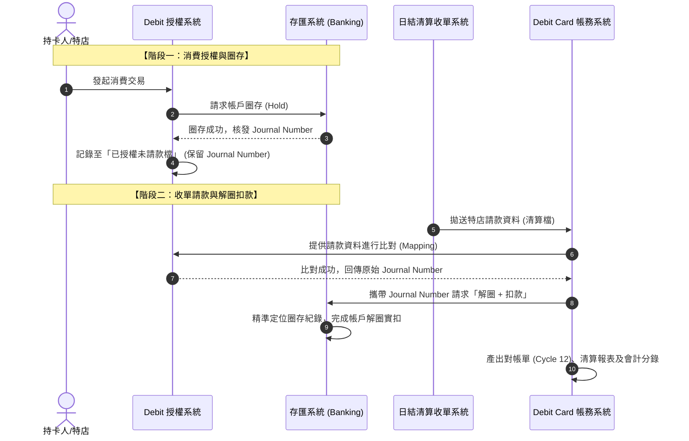
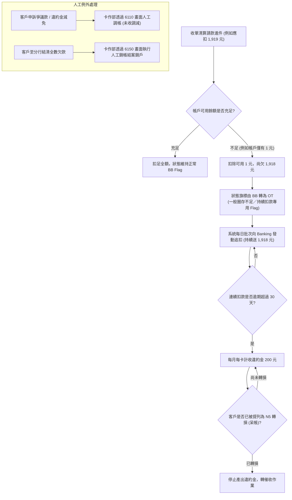

# 教育訓練知識筆記：新頂級卡、信用卡帳單與簽帳帳務架構

---

## 1. 本次課程摘要

* **課程主題**：新頂級卡專案規格、信用卡帳單產製與簽帳金融卡（Debit Card）帳務架構傳承
* **主講講師**：偉國（信用卡帳單與簽帳金融卡帳務 IT 負責人）
* **培訓對象**：新進 / 接手相關系統之 IT 團隊成員
* **背景脈絡**：因應銀行即將發行之新頂級卡專案（發卡規模龐大、跨多個 BU 與 PM），以及新同仁後續需協同把關 UAT 測試，講師針對專案全貌、系統定義、核心帳單批次以及簽帳金融卡帳務底層運作機制進行完整系統性知識傳承。
* **三大核心知識板塊**：
  1. **新頂級卡（Premium Card）專案背景與系統規格**：產品定位（Mastercard 頂級卡等 9、金屬卡）、期代與卡種定義（791）、專屬權益平台、貴賓室（PP／龍騰）整合機制、VIP Code 階層繼承、小數點回饋機制比照 CUBE 卡，以及專案執行之代理人爭議與二階段上線時程。
  2. **信用卡帳單（Billing）批次產製作業**：結帳批次跑檔、帳單檔格式下傳帳單生成系統、Cycle 週期劃分、主機查詢畫面（2015、013 台幣、016 雙幣美元），以及 6 個月歷史帳單調閱機制。
  3. **簽帳金融卡（Debit Card）帳務與沖銷機制**：存款帳戶圈存本質、系統建置於信用卡主機（與 Cardlink 脫鉤）、日結清算與授權解圈雙來源、Journal Number 交易序號比對扣款、扣款不足與每日追扣旗標（BB 轉 OT）、逾期每月 200 元違約金與轉損（N5）機制、主機維護畫面（2010/6030/6040/6110/6150），以及預授權（自助加油／飯店／匯差）扣款不足成因解析。

---

## 2. 知識架構

---

## 3. 核心概念

### 3.1 新頂級卡（Premium Card）系統定義與業務規格

* **是什麼（定義）**：
  本行為服務高端頂級客群所發行之旗艦級信用卡（實體卡為金屬卡 Metal Card），卡片等級為 Mastercard 最頂級等級（世界之極概念，系統卡等編碼為 9）。
* **為什麼存在（定位與目的）**：
  提供頂級客戶高度尊榮感與專屬權益，串聯全方位禮遇，並透過專屬入口平台集中呈現權益與福利。
* **核心系統參數與規則**：
  * **期代（Product Group Code）**：`2176`（行內信用卡產品群組分類代號，如長榮卡、蝦皮卡各有獨立期代）。
  * **卡種（Card Type）**：`791`。
    * 系統卡別三碼編碼規則（系統沿用向廠商 Cardlink 採購之架構，由行內自行維護）：
      * **第 1 碼（組織）**：`7` 代表 Mastercard 國際組織。
      * **第 2 碼（等級）**：`9` 代表頂級等級（如世界卡、頂級卡皆為 9；如 790、791）。
      * **第 3 碼（流水序號）**：序號識別碼。
  * **卡面代號（Card Face）**：如 `W2`。主機組裝製卡檔時，固定檔名中間會嵌入卡面代碼（例如 W2），卡廠收到製卡檔後依此識別套印並刻製專屬金屬卡面。
  * **BIN 碼**：由行內向國際組織（Mastercard）專案申辦取得之專屬 BIN 碼。
  * **正副卡貴賓室差異**：副卡與正卡在貴賓室權益之參數設定有所區隔。
  * **貴賓室機制變革**：
    * 早期主機系統曾產檔製發實體 PP 塑膠貴賓卡（Priority Pass），目前已全面停發。
    * 現行採雙軌整合：
      1. **信用卡直刷驗證**：持卡人於機場貴賓室出示該信用卡，貴賓室刷卡機讀取前八碼即可線上辨識持卡人是否符合免費使用資格。
      2. **龍騰卡（委外合作）**：進件審核通過後，系統將符合資格名單（客戶 ID）拋送龍騰廠商，持卡人出示龍騰 App 之 QR Code 即可進入貴賓室。
  * **權益手冊電子化**：以往隨卡附寄紙本權益手冊，新頂級卡全面改以電子郵件（Email）寄送電子權益手冊，不再印製紙本。
  * **VIP Code 階層與繼承規則**：
    * 新頂級卡預設賦予之 VIP Code 為 **`6`**（VIP 6）。
    * 系統 VIP 優先層級順序由高至低為：**`3 -> 2 -> 6 -> 8 -> 9 -> 5`**。
    * **繼承邏輯**：進件核發新頂級卡時，若持卡人原本無 VIP Code，則指派為 6；若持卡人原本已具備更高順位（例如 VIP 3 或 VIP 2），系統**保留原有之高等級，不予覆蓋降級**。
    * **每月檢核**：系統每月 10 號定期檢核持卡人頂級卡資格，若已停卡或不符資格，系統將依規則拔除 VIP Code。
  * **無額度註記之法規變更**：
    * 過去針對頂級客群，系統支援「不顯示信用額度」（營造刷卡無上限之尊貴感）。
    * **近期配合金融主管機關法規要求，該功能已全面取消上線**，所有頂級卡持卡人於實體卡簽單及帳單上均必須依法清楚揭示核准信用額度（例如 100 萬元）。
  * **小數點回饋機制（比照 CUBE 卡）**：
    * 回饋規則完全比照 CUBE 卡，不設消費門檻級距（無 Level 1／Level 3 之分），國內外一般消費一律固定回饋 1%（保留小數點）。
    * 特殊指定通路／海外領域（例如美國、日本、泰國等，或指定基金／特定投資交易）提供專屬免手續費或加碼優惠。
    * 點數回饋歷程比照 CUBE 卡點數歷程規格，將消費明細拋送信用卡中臺整合呈現。
  * **金屬卡掛失補發費用**：金屬卡製造成本高昂，持卡人申請掛失補發需收取工本費 **3,000 元**（相較長榮金屬卡因外盒包裝特殊收 5,000 元，頂級卡訂為 3,000 元）。
  * **數位通路優先呈現**：於 CUBE App / 行銀信用卡專區，新頂級卡強制排定在卡片輪播清單的第一張（首位展示）。

---

### 3.2 信用卡帳單（Billing）系統架構

* **是什麼（定義）**：
  主機於客戶指定結帳日批次彙整交易明細、應繳金額與信用資訊，產生標準帳單資料檔（Bill Data File），下傳給帳單生成系統產出對外帳單之完整作業。
* **核心作業流程**：
  * **Cycle 週期結帳**：信用卡客戶依結帳日劃分為 4 至 5 個 Cycle（例如 Cycle 1, 2, 3, 5 等）。
  * **批次產檔**：各 Cycle 結帳日當天系統跑完批次結帳後，自動擷取該 Cycle 所有客戶的消費明細與基本資料，組裝成帳單檔。
  * **跨系統下傳**：主機將帳單檔下傳至「帳單生成系統」（負責人：燕婷），由該系統套印格式後產生電子帳單（Email/簡訊）或紙本帳單寄送客戶。
* **帳單查詢與畫面代號**：
  * **`2015` 畫面**：主機線上帳單查詢畫面，提供依月份查詢持卡人歷史帳單明細。
  * **台幣與外幣代碼**：
    * `013`：台幣信用卡帳單。
    * `016`：雙幣卡之美元外幣帳單。
* **資料保存期限**：
  * **信用卡主機**：線上僅保留 **6 個月** 歷史帳單資料。
  * **歷史帳單平台**：超過 6 個月之歷史帳單已封存至歷史帳單平台供調閱（平台權責單位尚待講師確認）。

---

### 3.3 簽帳金融卡（Debit Card / 簽帳帳務）核心架構

* **是什麼（定義）**：
  Debit Card（簽帳金融卡）係與活期儲蓄存款帳戶綁定之支付卡片。消費時直接連動帳戶餘額，但系統本質上並非即時扣款，而是**「先圈存、後解圈扣款」**。
* **核心運作機制（圈存 vs. 扣款）**：
  * 刷卡授權當下，系統發動「圈存」（Hold Funds），將帳戶中的交易金額凍結佔用，避免持卡人重複動用該筆款項。
  * 待收單特約商店實際發動「請款」清算資料進件後，系統才向銀行存匯系統（Banking）發動「解圈並實扣」。
* **架構特色（關鍵背景）**：
  * **業界罕見架構**：多數金融機構將 Debit Card 帳務建立於核心存匯主機（Banking），但本行當年因內部專案權責劃分（Fighting 過程），最終**建置於「信用卡主機系統」**。
  * **與 Cardlink 完全脫鉤**：Debit Card 的請款與帳務處理與 Cardlink 信用額度帳務完全無關；清算資料進件後不會記入 Cardlink 帳戶餘額（Cardlink 帳面金額顯示為 0）。
* **資料來源雙軌機制**：
  1. **日結清算收單系統**：提供每日特店請款資料（清算檔）以及特店衍生手續費明細。
  2. **Debit Card 授權系統**：提供逾期「解圈」資料。若授權完成後特店超過 **14 天** 仍未請款，授權系統主動發起解圈通知，釋放圈存金額（註：信用卡授權佔額度之釋放天數通常為 30 天，由參數畫面控制）。
* **核心沖銷識別碼：Journal Number（交易序號）**：
  * **授權階段**：持卡人刷卡授權時，Banking 會核發一組唯一之 Journal Number，授權系統將此序號完整保存在「已授權未請款檔」中。
  * **請款比對（Mapping）**：收單清算檔進件時，Debit 帳務系統將請款明細送交授權系統進行 Mapping 比對。
  * **比對成功**：授權系統回傳原始之 Journal Number 給 Debit 帳務系統。
  * **下傳扣款**：Debit 帳務系統攜帶該 Journal Number 拋送 Banking，Banking 即可精準定位當初被圈存的該筆交易，順利執行「解圈＋正式扣款」。
* **逾期欠款與違約金計算規則**：
  * 當帳戶發生扣款失敗時，系統啟動每日延續扣款。
  * 若連續延續扣款超過 **30 天** 仍未扣足：系統對該卡每月計收違約金 **200 元**。
  * 違約金按月持續計收，直至該筆欠款被轉列呆帳／轉損（**N5 轉損**）；一旦進入轉損階段，系統即停止產出違約金。
* **系統主機操作與查詢畫面**：
  * **`2010` 畫面**：Debit Card 交易明細查詢畫面。
  * **`6030` 畫面**：單筆交易詳細軌跡 Log 查詢（包含解圈紀錄、扣款狀態及 Journal Number 歷程）。
  * **`6040` 畫面**：扣款失敗與不足記錄查詢畫面。
  * **`6110`（或稱 610）畫面**：人工調帳作業畫面（模擬信用卡 PCAD 交易架構開發，供卡作部／客服同仁為持卡人執行違約金減免或爭議款項調帳）。
  * **`6150` 畫面**：人工結帳銷戶畫面（客戶若至分行結清所有欠款辦理銷戶，卡作部同仁於此畫面執行結案銷帳，正式關閉帳戶）。

---

## 4. 重要流程

### 4.1 新頂級卡專案推進與二階段上線時程

---

### 4.2 信用卡帳單產製與寄送作業流程

---

### 4.3 簽帳金融卡授權、請款與解圈扣款全流程

---

### 4.4 Debit Card 扣款失敗追扣與違約金處理流程

---

## 5. 系統／角色關係

### 5.1 涉及系統清單與架構關係

| 系統名稱 | 系統定位 / 所屬環境 | 核心職責與資料流向 |
|---|---|---|
| **信用卡主機（Mainframe）** | 核心主機系統 | 執行信用卡批次結帳、組裝帳單檔；亦為本行 **Debit Card 帳務之底層宿主系統**。 |
| **Cardlink 系統** | 信用卡套裝核心 | 維護信用卡產品核心參數（如卡種 791、期代 2176）；**與 Debit Card 帳務完全脫鉤（不入帳）**。 |
| **信用卡中臺** | 中台整合系統 | 整合 CUBE 點數歷程、接收主機消費明細、接收 MIS 資格檔，對外提供前台通路資格查詢。 |
| **MIS 系統** | 數據分析與累計系統 | 耗費大量人力計算新頂級卡滿額禮、美食等權益累計，生成「資格檔」拋送信用卡中臺。 |
| **帳單生成系統** | 周邊產檔系統（燕婷負責） | 接收主機下傳之帳單檔（Cycle 1~5 及 Debit Cycle 12、商務 Cycle 9），排版生成電子/紙本帳單。 |
| **Banking（存匯系統）** | 核心銀行主機 | 掌管持卡人活儲帳戶，執行授權圈存、核發 Journal Number、執行解圈扣款與退款。 |
| **Debit 授權系統** | 授權主機 | 處理交易授權、維護「已授權未請款檔」、執行請款 Mapping 回傳 Journal Number、逾期 14 天發動解圈。 |
| **日結清算收單系統** | 收單清算系統 | 每日彙整特約商店請款清算檔，計算衍生手續費並拋送 Debit Card 帳務系統。 |
| **龍騰卡／PP 廠商系統** | 外部委外貴賓室系統 | 接收進件拋送之符合資格客戶名單（ID），提供持卡人機場貴賓室 QR Code 驗證服務。 |
| **製卡廠系統** | 外部實體卡片刻印廠 | 接收主機產製之製卡檔，依檔名中之卡面代碼（如 W2）套版製作專屬金屬卡。 |
| **會計系統** | 總帳會計系統（應政負責） | 接收 Debit Card 產出之會計傳票分錄檔，會計科目代碼與借貸方向已 Hardcode 於程式中。 |
| **歷史帳單平台** | 歷史歸檔查詢平台 | 保存超過 6 個月以上之歷史帳單資料供調閱（系統負責單位待確認）。 |

### 5.2 相關角色與職責

| 角色／人員 | 所屬單位 | 本次培訓涉及之職責與互動 |
|---|---|---|
| **偉國** | IT 帳單與簽帳帳務 | 本次講師；今年年中接手帳單與簽帳金融卡業務，負責系統知識傳承與規格說明。 |
| **學員（IT 同仁）** | IT 團隊 / 新進成員 | 接收系統傳承，後續將協同把關頂級卡專案 UAT 測試劇本與關聯程式影響範圍。 |
| **消金業務 PM（星光/User PM）** | 消費金融業務單位 | 提出新頂級卡業務概述、匯整各 BU 需求書；因專案龐大且經驗不足，初期造成需求未定即 Kick-off。 |
| **天靈（PM）** | 專案管理 PM | 統籌新頂級卡專案 UAT 測試，彙整各 BU 測試劇本並排定跨系統測試行事曆。 |
| **翠如** | 專案主管 / 協調同仁 | 指派並提醒 IT 學員需儘早熟悉頂級卡架構以協助把關 UAT。 |
| **燕婷** | 帳單生成系統負責人 | 掌管帳單生成系統，負責接收主機下傳之帳單檔產製格式化對外帳單。 |
| **文華** | IT 前手（卡務/帳單） | 偉國之業務交接前手，傳承製卡檔與帳單檔規格。 |
| **佩儀** | IT 卡務負責人 | 目前負責主機信用卡製卡檔產製作業。 |
| **應政** | 會計系統負責人 | 負責接收並維護主機拋送之 Debit Card 會計分錄與總帳報表。 |
| **卡作部／客服同仁** | 營運作業單位 | 於線上操作 6110 畫面進行客戶人工調帳，或於 6150 畫面進行客戶結清銷戶作業。 |

---

## 6. 關鍵名詞

| 名詞 | 英文／縮寫 | 說明 |
|---|---|---|
| **期代** | Product Group Code | 本行行內信用卡產品群組分類代號（頂級卡為 `2176`）。 |
| **卡種** | Card Type | Cardlink 架構之產品代碼（頂級卡為 `791`；7=Mastercard, 9=世界/頂級卡等級, 1=序號）。 |
| **金屬卡** | Metal Card | 頂級卡實體材質，製程成本高，掛失補發工本費收取 3,000 元。 |
| **卡面代號** | Card Face Code | 製卡檔識別代號（如 `W2`），提供卡廠識別刻印樣式。 |
| **BIN 碼** | Bank Identification Number | 銀行識別碼，由行內向國際組織（Mastercard）專案申請核發。 |
| **VIP 代碼** | VIP Code | 客戶尊榮等級代碼。頂級卡為 `6`；系統優先順序為 `3 -> 2 -> 6 -> 8 -> 9 -> 5`。 |
| **圈存** | Hold / Block Funds | Debit Card 授權時暫行凍結存款帳戶內交易金額，避免被其他交易重複動用之機制。 |
| **解圈** | Release Hold | 特店請款扣款成功或逾期 14 天未請款時，系統解除帳戶凍結金額之動作。 |
| **交易序號** | Journal Number | Banking 於圈存時核發之唯一追蹤流水號，授權系統保留後供請款清算精準 Mapping 扣款。 |
| **正常扣款旗標** | BB Flag | Debit Card 帳務專用之正常扣款／處理旗標。 |
| **不足追扣旗標** | OT Flag | Debit Card 請款但帳戶餘額不足時之專用旗標，系統將啟動每日持續向 Banking 追扣。 |
| **人工調帳畫面** | Screen 6110 (610) | 模擬信用卡 PCAD 交易架構開發之 Debit Card 線上調帳畫面（供卡作部調減違約金等）。 |
| **銷戶銷帳畫面** | Screen 6150 | 客戶結清 Debit 帳戶欠款後，卡作部同仁執行人工結案與關閉帳戶之畫面。 |
| **轉損（呆帳）** | N5 / Charge-off | 逾期帳款經長期催收未果轉列虧損呆帳之狀態；一旦進入 N5 轉損，系統停止計收違約金。 |
| **預授權** | Pre-authorization (Pre-auth) | 交易當下僅驗證卡片有效性並圈存極低金額（如 1 元），後續依實際請款實扣之交易型態。 |
| **請款完成** | Pre-auth Completion | 預授權後續特店發送之實際請款交易（如自助加油後拋送之實際加油金額清算檔）。 |

---

## 7. 重要概念比較

### 比較 1：信用卡（Credit Card） vs. 簽帳金融卡（Debit Card）底層架構

| 比較維度 | 信用卡（Credit Card） | 簽帳金融卡（Debit Card） |
|---|---|---|
| **扣款本質** | 動用信用額度，先行墊款、次月結帳 | 連動存款帳戶，**先圈存（凍結餘額）、請款時再解圈實扣** |
| **系統宿主** | 信用卡主機核心 | **信用卡主機系統**（本行特殊歷史架構，非建置於 Banking） |
| **與 Cardlink 關係** | 核心入帳系統，記錄所有消費餘額與額度 | **完全脫鉤**；請款進件不入 Cardlink，帳面金額永遠為 0 |
| **授權未請款釋放** | 佔用信用額度；若特店未請款約 **30 天** 自動釋放額度 | 圈存活儲資金；若特店逾期 **14 天** 未請款，授權系統發動解圈 |
| **對帳單週期** | 多 Cycle 制（Cycle 1, 2, 3, 5 等） | **固定 Cycle 12**（商務卡則固定為 Cycle 9） |

### 比較 2：新頂級卡（VIP 6） vs. 舊世界卡（VIP 3）階層邏輯

| 比較項目 | 舊制世界卡（VIP 3） | 新頂級卡（VIP 6） |
|---|---|---|
| **核發時間背景** | **2006 年 6 月 30 日之前** 核發之世界卡 | 本專案最新發行之旗艦頂級卡 |
| **稀有度與定位** | 早期極度稀有尊貴，系統給予終生最高保障 | 現行最高階頂級卡，但系統層級排序設為 6 |
| **系統優先順序** | 優先順位第 1 位（`3 -> 2 -> 6...`） | 優先順位第 3 位（排在 3 與 2 之後） |
| **增減異動狀態** | 代碼已凍結，**不再新增**，僅存量保留 | 隨進件正常動態指派與退階檢核 |
| **覆蓋繼承規則** | 持有者申請頂級卡，**保留 VIP 3 不被降級覆蓋** | 若持卡人原本無 VIP Code，核卡後指派為 VIP 6 |

### 比較 3：貴賓室驗證機制演進

| 驗證模式 | 早期實體 PP 卡 | 現行信用卡直刷驗證 | 現行龍騰卡整合 |
|---|---|---|---|
| **媒介形式** | 系統產檔寄發之塑膠貴賓卡 | 原信用卡實體卡片 | 龍騰出行手機 App (QR Code) |
| **系統判定方式** | 獨立 PP 卡號刷驗 | 刷卡機讀取**前八碼（BIN/卡號前綴）** | 進件拋送客戶名單（ID）至龍騰主機 |
| **維護成本** | 高（需額外製卡、寄卡、管理卡號） | 最低（利用既有信用卡過卡識別） | 中等（需定期拋送符合資格名單檔） |
| **現況** | **已全面停發** | 現役主要管道 | 現役合作管道 |

### 4. 金屬卡掛失補發費用比較

| 卡片名稱 | 卡片等級 | 補發工本費 | 費用差異原因（講師說明） |
|---|---|---|---|
| **長榮金屬卡** | 聯名頂級卡 | **5,000 元** | 當初需求書規範外盒包裝較為繁複奢華，成本較高。 |
| **新頂級卡** | 銀行頂級卡 | **3,000 元** | 回歸合理金屬卡製造成本，訂為 3,000 元。 |

---

## 8. 講師案例

### 案例 1：Debit Card 自助加油站「預授權 1 元」引發扣款不足
* **情境描述**：
  持卡人至自助加油站刷 Debit Card 加油。自助加油機為確認卡片是否為有效卡，交易當下 Visa/Mastercard 僅發動 **預授權圈存 1 元**。
* **問題發生**：
  持卡人實際加了 500 元的油，特店於數日後以實際消費金額 500 元送來請款清算檔。此時若持卡人活儲帳戶內餘額已低於 500 元（例如僅剩 20 元），Banking 扣款即宣告失敗。
* **系統處理**：
  扣款金額不足，系統自動將該筆交易旗標由 **BB 改為 OT**，並每日自動重送 Banking 扣款嘗試追償。

### 案例 2：Debit Card 國外交易匯率波動引發扣款不足
* **情境描述**：
  持卡人於海外網站刷卡消費外幣，授權當下依當日即期匯率圈存（假設折合台幣 500 元）。
* **問題發生**：
  數日後特店清算檔進件時，因國際匯率劇烈波動或衍生跨國交易手續費，最終請款台幣金額變為 520 元。若持卡人存款帳戶在此期間已無額外餘額，便產生 20 元之扣款差額。

### 案例 3：請款 1,919 元僅扣到 1 元之系統狀態轉換
* **數據呈現**：
  特店請款進件 1,919 元，持卡人活存帳戶僅剩 1 元。
* **處理過程**：
  Banking 執行解圈並扣除僅有的 1 元，剩餘未清償欠款為 **1,918 元**。
* **旗標變化**：
  系統將此 1,918 元欠額回饋標記為 **OT** 旗標。Debit 帳務系統排程啟動每日追扣機制，每天持續向 Banking 發送 1,918 元扣款要求，直到持卡人帳戶補入資金扣足為止。

### 案例 4：新頂級卡專案專屬秘書／客服代理人爭議
* **事件經過**：
  消金業務 PM 提出「新頂級卡專屬秘書／客服代理人」需求，初期在未與 IT 充分評估下，逕自於需求書指定由「信用卡主機」開發。
* **衝突引爆**：
  主機團隊認為該功能本質偏向前台客服與開放平台應用，強烈主張應建置於 Open 平台（開放系統），引發主機與 Open 平台之間的權責推諉與爭議。
* **最終解法**：
  評估 MIS 團隊人力已被滿額禮與各項權益累計佔滿，最快需至 12 月方能釋放人力展開需求細部討論、明年 4 月進行測試。因此決議專案採二階段推進：**明年 1 月新頂級卡如期發卡上線（前期專屬代理人服務暫由客服營運同仁以人工方式支援），明年 4 月系統化代理人機制再正式上線**。

---

## 9. 講師特別提醒

1. **Debit Card 帳務坐落在信用卡主機，但與 Cardlink 系統完全脫鉤**：
   > 「新人最容易搞混！雖然 Debit Card 帳務是跑在我們信用卡主機上，但它跟 Cardlink 一點關係都沒有，請款進來完全不入 Cardlink 帳，Cardlink 上的帳額永遠是 0。」
2. **協同 UAT 切忌流於表面，需發揮 IT 視角檢視關聯程式**：
   > 「業務 BU 寫測試劇本常常偷懶，只測他改的那顆按鈕或單一流程。IT 參與 UAT 的關鍵價值是『看頭看尾』，因為只有 IT 知道改這支程式會動到什麼底層模組或周邊報表，要主動揪出漏測的項目。」
3. **VIP Code 繼承原則：不可覆蓋更高階之既有代碼**：
   > 「新頂級卡雖然等級最高，但 VIP Code 給的是 6。如果進件客戶原本就持有 2006 年之前的舊世界卡（VIP 3），系統絕對不能把它降級改成 6，必須保留原有的 3。」
4. **無額度註記功能已因法規全面廢止**：
   > 「以前頂級卡可以在帳單或簽單隱藏額度讓客戶覺得無上限，最近因為金管會法規嚴格要求，這個功能已經全面拔掉了，現在帳單上一律必須清楚顯示核准額度。」
5. **Debit Card 違約金計收到轉損（N5）即停止**：
   > 「扣款不足若逾期 30 天，系統會按月每卡收取 200 元違約金。但不會無限收下去，只要帳款被提列為 N5 轉損（轉入呆帳），系統就會自動停止產出違約金。」

---

## 10. Q&A

### Q1：新同仁或 IT 團隊應如何參與新頂級卡專案的 UAT 測試？
* **問題背景**：學員提及主管翠如指示需協助專案 UAT，詢問具體應扮演何種角色與切入點。
* **講師解答**：
  * **專案統籌機制**：專案由 PM 天靈負責統籌 UAT，負責收集各業務 BU 的測試案例，排定跨系統測試行事曆與情境劇本。
  * **IT 把關定位**：IT 的核心職責不是單純跟著 BU 點畫面，而是站在技術與系統架構的角度，審視 BU 的測試劇本是否遺漏關聯系統改動（例如周邊績效系統、報表系統、中台資格檔等是否有隨同納入驗證），扮演全面檢視防漏的角色。

### Q2：新頂級卡理應是最尊貴的卡片，為何系統 VIP Code 排序（VIP 6）會低於世界卡（VIP 3）？
* **問題背景**：學員閱讀規格書時發現，新頂級卡對應 VIP 6，但優先層級排序卻落在 `3 -> 2 -> 6` 之後，質疑卡等邏輯是否矛盾。
* **講師解答**：
  * **歷史背景解密**：排序最前方的 **VIP 3 是專屬 2006 年 6 月 30 日之前發行的舊制世界卡**。
  * 早期世界卡極端稀有、門檻極高，因此系統架構給予該批原始客戶最高優先順位。該代碼現已「凍結不新增」，僅供歷史存量客戶保留；後續發行之新世界卡已降為一般卡等 9。
  * 新頂級卡在現行常態運作中即為實質最高等級（指派 VIP 6），若持卡人原本擁有歷史尊榮 VIP 3，系統予以保留而不向下覆蓋。

### Q3：Debit Card 本質上是有多少存款圈多少錢，理論上已被圈存鎖定，為何還會發生請款扣款不足或失敗？
* **問題背景**：學員難以理解，既然刷卡時已完成圈存（Hold），帳戶資金照理不會被其他人動用，為何特店請款進件時還會扣款失敗？
* **講師解答**：
  * 正常單純交易確實不會失敗，但實務上存在特殊交易情境：
    1. **國外交易匯差**：圈存依當日匯率計算，數日後清算請款時因匯率變動或海外手續費導致台幣結算金額增加，超出原圈存金額。
    2. **預授權（Pre-authorization）情境**：如自助加油機或飯店 Check-in，授權當下為驗證卡片有效性僅先圈存 1 元（或極低金額），加完油或退房後送達之實際請款金額（如 500 元）才是實扣金額。若持卡人此時活儲帳戶已無足夠餘額，就會造成扣款不足。

### Q4：既然 Debit Card 預授權容易因存款不足引發倒帳風險，為何系統不直接將預授權（Pre-auth）交易鎖定禁止？
* **問題背景**：學員追問，若預授權有扣不到錢的風險，為何不從系統規格上直接封鎖 Debit Card 的 Pre-auth 交易？
* **講師解答**：
  * 這屬於**業務政策（Policy）與國際組織規範**範疇。
  * 自助加油、飯店入住等屬於國際主流消費情境，若直接鎖定將嚴重影響持卡人支付體驗與用卡意願。
  * 各國際組織（Visa 與 Mastercard）對預授權風險承擔與保證請款有各自的規範與額度設定，業務端與風控單位基於整體業務權衡所訂立之政策，通常不會對 IT 完全揭露。

---

## 11. 尚待釐清

1. **歷史帳單平台負責單位（System Owner）**：
   主機僅保留 6 個月帳單資料，超過 6 個月需調閱歷史帳單平台；該平台目前由何單位負責維護，講師當下未能確認，待後續向相關人員查證後回覆。
2. **信用卡授權佔額之自動釋放天數**：
   授權後若特店未請款，Debit Card 授權系統設定為 14 天自動解圈；信用卡授權佔用額度之自動釋放天數，講師印象中為 30 天（可由卡系統參數畫面設定），具體參數天數待進一步核對系統設定檔。
3. **國際組織與業務端對預授權交易之詳細 Policy**：
   針對 Debit Card 預授權交易（自助加油、飯店住宿）之風險承擔額度與卡組織特定規則，涉及業務與風控內部政策，IT 端尚待業務單位提供正式規範。

---

## 12. 補充知識

> [!NOTE]
> 以下內容並非原始逐字稿內容，而是補充說明，旨在協助學習者完整理解銀行信用卡與簽帳金融卡相關底層運作原理。

### 補充 1：ISO 8583 預授權（Pre-authorization）與請款完成（Pre-auth Completion）機制
* **預授權（MTI 0100 / Processing Code）**：
  特約商店在持卡人消費金額尚未最終確定前（例如飯店入住押金、租車押金、自助加油），向發卡行發起預先佔額請求。發卡行驗證卡片有效性並凍結特定信用額度或存款餘額。
* **請款完成（MTI 0200 / 0220 / Clearing）**：
  當服務完成、消費金額確定後，特店透過收單行發送請款完成交易，此時才依據實際發生金額發動扣款與清算。若實際金額超出當初預授權凍結之金額且存款不足，即衍生銀行墊付或扣款失敗風險。

### 補充 2：銀行會計之「轉損（Charge-off / N5）」定義
* **催收階段與呆帳提列**：
  銀行逾期帳款一般依逾期月數劃分為正常、催告、轉催收與轉列呆帳。在許多核心系統中，`N5` 代表逾期達一定天數（通常為轉催收後經一定期間催討無果）經董事會核准轉列呆帳（Charge-off / 轉損）。
* **停止計收利息與違約金**：
  一旦帳款正式轉列呆帳（轉損），依據會計準則與銀行內部規範，系統必須將該筆債權轉入帳外備查簿列管，並**全面停止按月計提利息與違約金**，以避免虛增銀行應收利息收入，轉由法金/消金催收部門專責進行法律追償。
