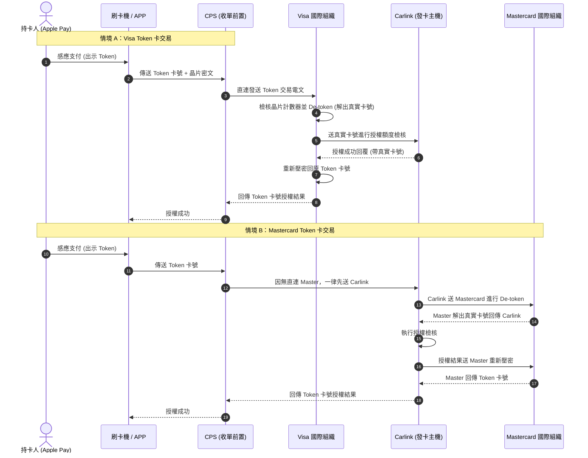

# 教育訓練知識筆記：收單前置系統（CPS）與清分清算模組（MAPS）架構與帳務全貌

## 1. 本次課程摘要

- **課程講師**：建成
- **參訓對象**：CMA 儲備幹部（輪調學習收單、發卡與核心科系統業務）
- **主題核心**：收單前置系統（CPS）與跨日清分清算模組（MAPS）架構、即時交易授權路由、加密與代碼化（Token）機制、TWQR 帳戶圈存、跨日清算請款與特店撥款帳務全流程。
- **學習核心目標**：
  1. **掌握即時授權前置處理**：理解網路交易（EC）、數位支付（PH）、實體刷卡機（EDC）三大通路如何匯聚於收單前置系統（CPS），並轉換為 ISO 8583 金融標準電文進行分流繞送。
  2. **透析 Token 與加解密機制**：釐清國際 Pay（Apple Pay 等）Token 卡之 De-token 流程、Visa 直連與 Mastercard 轉接差異、晶片計數器防偽檢核，以及銀聯卡經由 HSM 進行 PIN 碼轉密的硬體安全機制。
  3. **釐清跨日清分清算與撥款雙軸線**：徹底區分「收單向發卡行/國際組織清算請款」與「收單行撥款給特約商店」兩大時間差獨立流程，理解收單行代墊款之本質。
  4. **熟稔特殊業務情境與責任歸屬**：掌握 3DS 爭議款責任判定原則、TWQR 跨行帳戶圈存與專戶對沖、刷卡機離線交易（以歷史 Costco 案例為例）與飯店預授權補登實務。

---

## 2. 知識架構

本課程知識架構涵蓋四大層次：前端通路收容層、前置授權交換層、跨日清分清算與撥款層，以及外部監管報送層。

```mermaid
flowchart TD
    subgraph 通路收容層 [前端通路收容層]
        EC["網路交易 (EC/APP)<br/>Momo/蝦皮等"] -->|公網 HTTPS| WAF["對外入口防火牆 (WAF)"]
        QR["數位支付 (PH/QR)<br/>Open錢包/全家等"] -->|公網 HTTPS| WAF
        WAF --> EPOS["EPOS (網路收單前置)<br/>處理 3DS/OTP"]
        WAF --> PH["PaymentHub (PH)<br/>QR 碼解析/轉電文"]
        EDC["實體刷卡機 (EDC)<br/>實體特店/超商"] -->|90% 專線直連| CPS
        EDC -.->|少數 Internet+憑證/HMAC| CPS
        EPOS --> CPS
        PH --> CPS
    end

    subgraph 前置授權層 [收單前置核心 (CPS)]
        CPS["CPS (收單前置系統)<br/>轉換 ISO 8583 標準電文"]
        
        CPS -->|本行一般卡| Carlink["Carlink (發卡主機)"]
        CPS -->|他行卡| NCCC["NCCC (聯卡中心)"]
        NCCC --> OtherBank["他行發卡行"]
        
        CPS -->|Visa Token 卡| Visa["Visa 國際組織<br/>(De-token 還原實體卡)"]
        Visa --> Carlink
        Carlink -->|授權結果| Visa
        Visa -->|重新壓回 Token 卡號| CPS
        
        CPS -->|Mastercard Token 卡| Carlink
        Carlink --> Master["Mastercard 組織<br/>(De-token 還原實體卡)"]
        Master --> Carlink
        
        CPS -->|銀聯卡 Debit/PIN| HSM["HSM (硬體安全模組)<br/>刷卡機 Key 轉 銀聯 Key"]
        HSM --> NCCC
        NCCC --> CUP["中國銀聯 (發卡行驗密)"]
        
        CPS -->|TWQR 跨行交易| EFT["EFT Gateway"]
        EFT -->|他行帳戶| FISC["財金公司 (跨行圈存)"]
        EFT -->|本行帳戶| BankHost["Bank 主機 (本行圈存)"]
        FISC --> EFT
        EFT -->|圈存成功入專戶| BankHost
    end

    subgraph 清算撥款層 [跨日批次與帳務處理 (MAPS)]
        EPOS & PH & EDC -->|夜間 12:00 匯總請款檔| MAPS["MAPS (清分清算模組)"]
        
        MAPS -->|本行卡清算檔| Carlink
        Carlink -->|下帳扣款| Customer["持卡人信用卡帳戶"]
        
        MAPS -->|國內他行 001 檔 / 國際 101 檔| AcqOuter["實體收單外圍 (怡婷組)"]
        AcqOuter --> NCCC
        NCCC -->|跨行清算請款| OtherBank & Visa & Master & CUP
        
        MAPS -->|特店撥款明細檔| AcqOuter
        AcqOuter -->|彙整勾稽與扣除手續費| CardOps["卡務作業科 (卡作)"]
        CardOps -->|覆核確認| Remit["存匯系統"]
        Remit -->|轉帳撥款| Merchant["特約商店銀行帳戶"]
    end

    subgraph 監管報送層 [外部機構法規報送]
        MAPS -->|每日特店資料與交易明細| JCIC["聯合徵信中心 (JCIC)"]
        MAPS -->|小規模營業人每月總營業額| TaxCenter["財稅資料中心 (免稅/減稅)"]
    end
```

---

## 3. 核心概念

### (1) 收單前置系統（CPS / Card Processing System）
- **是什麼**：信用卡收單端的核心前置交易交換與通訊中樞系統（逐字稿中常口傳音譯為「卡珀 / CPS」）。
- **為什麼存在**：
  - 前端各通路（網路電商 EPOS、行動 QR 支付 PaymentHub、各型實體刷卡機 EDC）進件的資料型態相異。
  - 若各通路自行對接發卡行或國際組織，系統介接將極度複雜混亂。
  - 業界具備法定的統一金融電文標準（ISO 8583），必須由統一的前置系統進行規格轉換。
- **如何運作**：
  1. 收容前端所有通路送入的授權交易請求。
  2. 將相異格式組合組裝為國內外通行的標準 ISO 8583 規範電文格式。
  3. 根據卡號 BIN 碼與交易屬性判斷路由，分流繞送至本行發卡主機（Carlink）、他行轉接中心（NCCC）、國際組織（Visa）或轉接閘道（EFT Gateway）。
  4. 接收後端授權結果後，依原路徑包裝電文回傳給前端發起通路。
- **與其他概念的關係**：
  - 上游銜接 WAF、EPOS、PH、EDC；下游介接 Carlink、NCCC、Visa、HSM、EFT Gateway。
  - 日間負責即時「線上交易授權（Authorization）」，夜間則由 MAPS 系統接棒進行「批次清分清算（Clearing & Settlement）」。
- **實際案例**：持卡人在 Momo 購物網結帳時，Momo 將資料丟入 WAF → EPOS → CPS，CPS 組裝 ISO 8583 電文後丟給發卡組織確認額度並回傳成功訊息。

---

### (2) 清分清算模組（MAPS / Merchant Acquiring Processing System）
- **是什麼**：收單體系負責跨日批次帳務匯總、清分（Clearing）與清算（Settlement）的核心帳務系統（逐字稿中稱為「Maxs / Miss」）。
- **為什麼存在**：即時授權僅代表卡片額度或帳戶資金被凍結/批准，並未實際進行跨行資金搬移；每日營運結束後，必須進行完整的帳務對帳、手續費計算、向發卡行收錢（請款），以及撥款給特約商店。
- **如何運作**：
  1. **資料收容**：每日夜間 12:00 過後，收容 EPOS、PH 系統及實體刷卡機（EDC）上傳之當日結帳批次請款資料。
  2. **清分處理**：
     - **本行卡**：產出本行扣款檔，拋送 Carlink 發卡主機向本行持卡人請款下帳。
     - **他行卡**：產出清算檔，區分為國內他行（`001 檔`）與國際組織（`101 檔`），拋送實體收單外圍轉由 NCCC 向各銀行或國際組織請款。
  3. **特店撥款**：計算特店手續費、產出對帳單與撥款明細，送交實體收單外圍與卡片作業科（卡作）覆核，隔日中午由存匯系統撥入特店帳戶。
- **與其他概念的關係**：CPS 處理 Online 即時交易；MAPS 處理 Batch 跨日清算。

---

### (3) 代碼化交易（Token）與去代碼化（De-token）
- **是什麼**：將實體信用卡 16 碼卡號轉換為一組無直接關聯的虛擬代碼（Token），應用於 Apple Pay、Google Pay、Samsung Pay 等行動支付錢包。
- **為什麼存在**：避免真實卡號在商家端、開放網路或外部手機系統中以明文流通，即使代碼遭截錄亦無法在其他環境偽冒盜刷。
- **如何運作**：
  - 手機感應或 Apple Pay 支付時，送出的均為虛擬 Token 卡號，並附帶手機晶片運算出的動態加密欄位與交易計數器（Counter）。
  - **Visa 交易路徑**：CPS 直連 Visa 國際組織，Visa 驗證晶片與計數器無誤後進行 **De-token（去代碼化）** 還原出真實卡號，再送 Carlink 驗證額度進行授權。授權成功後，Visa 必須**重新將實體卡號壓密還原為 Token 卡號**再送回 CPS。
  - **Mastercard 交易路徑**：CPS 未直連 Master，交易一律送 Carlink，由 Carlink 丟給 Mastercard 進行 De-token 取得實體卡號授權，回程同樣壓回 Token。
- **安全關鍵檢核**：
  - Visa 會檢核晶片交易計數器（Counter）。若黑客側錄感應資料並嘗試重放（Replay Attack）相同計數器交易，Visa 會識別重複發送而直接阻擋。
  - Token 卡號若被拿去一般非 Apple Pay 的網路手動輸入（EC），國際組織會識別環境不符直接拒絕。

---

### (4) 硬體安全模組（HSM / Hardware Security Module）
- **是什麼**：具備防竄改實體防護之專用金融加解密硬體設備。
- **為什麼存在**：金融密碼（如金融卡 Debit PIN 碼、預借現金密碼）不得在作業系統、網路或軟體記憶體中以明文出現，軟體加密有遭破譯風險，必須依賴物理隔離的硬體加密機。
- **如何運作（銀聯卡 Debit PIN 轉密案例）**：
  1. 持卡人在刷卡機輸入 PIN 碼（如 1234），刷卡機使用 EDC Key 加密後送入 CPS。
  2. CPS 看到的是亂碼，將密文丟入 HSM。
  3. HSM 在硬體內部使用刷卡機 Key 解開密碼，**立即使用銀聯規範的 Key 重新包裝加密**，再送回 CPS。
  4. CPS 依然只看到密文，將重新加密後的電文透過 NCCC 送往中國銀聯發卡行驗證。
  5. 過程中 CPS 全程無法窺視密碼明文。

---

### (5) TWQR 交易機制與 EFT Gateway
- **是什麼**：以共同標準（TWQR）掃碼之帳戶扣款機制（源自台灣 Pay），其本質為**銀行活期存款帳戶圈存扣款**，而非信用卡信用授權。
- **為什麼存在**：整合多元電子支付與銀行帳戶掃碼，使跨行帳戶能直接於特店扣款消費。
- **如何運作**：
  1. 消費者於特店出示 TWQR，條碼由 PaymentHub 解析為電文送入 CPS。
  2. CPS 識別為 TWQR 後轉發 EFT Gateway（電子資金轉帳閘道）。
  3. EFT 依綁定帳戶路由：
     - **他行帳戶**：發送電文至財金公司（FISC），轉請發卡行（如第一銀行）執行即時帳戶圈存（Hold 款）。
     - **本行帳戶**：直接發送電文至 Bank 主機執行圈存。
  4. 圈存成功後，EFT 同步將交易金額記入 Bank 主機的「特店撥款專款專戶」。
  5. 夜間 EFT 勾稽財金清算金額與專款專戶金額平帳後，將款項撥入特約商店。

---

## 4. 重要流程

### 流程一：即時交易授權前端三大通路路由流程

```
[線上交易 EC/APP] ───> [WAF 防火牆] ───> [EPOS (3DS驗證)] ──────┐
                                                                 │
[數位支付 PH/QR]  ───> [WAF 防火牆] ───> [PaymentHub (解析QR)] ──┼───> [CPS 收單前置]
                                                                 │     (組裝 ISO 8583)
[實體刷卡機 EDC]  ───> (90% 專線直連，不經 WAF) ──────────────────┘
```

---

### 流程二：Visa vs Mastercard 代碼化（Token）交易授權差異



---

### 流程三：銀聯卡 Debit PIN 碼轉密流程（HSM）

```mermaid
sequenceDiagram
    autonumber
    actor Customer as 持卡人
    participant EDC as 實體刷卡機
    participant CPS as CPS 收單前置
    participant HSM as HSM (硬體安全模組)
    participant NCCC as NCCC (聯卡中心)
    participant CUP as 中國銀聯發卡端

    Customer->>EDC: 輸入提款密碼 PIN (如 1234)
    EDC->>EDC: 使用刷卡機 Key 加密 PIN 碼
    EDC->>CPS: 傳送密文電文
    Note over CPS: CPS 全程看不到明文密碼
    CPS->>HSM: 傳入密文 + 刷卡機 Key 識別
    HSM->>HSM: 硬體隔離區解密 (1234)<br/>立即改用銀聯 Key 重新加密
    HSM-->>CPS: 回傳新密文 (銀聯格式)
    CPS->>NCCC: 傳送轉密後電文
    NCCC->>CUP: 繞送至大陸發卡行
    CUP->>CUP: 驗證 PIN 碼正確性
    CUP-->>NCCC-->>CPS: 授權成功回覆 (不需再經 HSM 解密)
    CPS-->>EDC: 回傳授權結果
```

---

### 流程四：TWQR 跨行帳戶圈存與專戶撥款流程

```mermaid
sequenceDiagram
    autonumber
    actor User as 消費者
    participant Shop as 特約商店 (如 7-11)
    participant PH as PaymentHub
    participant CPS as CPS 收單前置
    participant EFT as EFT Gateway
    participant FISC as 財金公司 (FISC)
    participant OtherBank as 他行 (如第一銀行)
    participant BankHost as Bank 主機 (專款專戶)

    User->>Shop: 出示 TWQR 條碼
    Shop->>PH: 掃碼送入條碼資訊
    PH->>CPS: 解析條碼轉成交易電文
    CPS->>EFT: 辨識為 TWQR，轉送 EFT Gateway
    EFT->>FISC: 轉發跨行扣款圈存請求
    FISC->>OtherBank: 通知第一銀行扣款 10 元
    OtherBank->>OtherBank: 帳戶圈存 10 元成功
    OtherBank-->>FISC-->>EFT: 回覆圈存成功
    EFT->>BankHost: 通知 Bank 主機入帳 10 元至「特店專款專戶」
    EFT-->>CPS-->>Shop: 交易成功回覆
    Note over EFT, BankHost: 夜間批次：EFT 對沖勾稽財金清算款與專戶平帳<br/>平帳後撥款特店，帳不平則暫扣 (Hold)
```

---

### 流程五：跨日清分清算（MAPS）與特店撥款雙軸線流程

> [!IMPORTANT]
> **收單核心本質**：「向發卡行清算請款」與「撥款給特店」是**完全獨立的兩條時間軸**。收單行於交易次日中午即先代墊款項撥付給特店，事後才透過 NCCC 或國際組織向發卡行收取清算款。

```mermaid
flowchart TD
    subgraph 夜間批次起點
        A["每日 24:00 營業日結算"] --> B["收容 EPOS / PH / EDC 上傳結帳請款檔"]
        B --> C["MAPS 清分清算模組"]
    end

    subgraph 軸線一：收單對發卡行清算請款 [收款軸線：T+2 至數日]
        C --> D1["自行交易請款檔"]
        D1 --> E1["Carlink 發卡主機"]
        E1 --> F1["向本行持卡人信用卡下帳扣款"]

        C --> D2["他行交易清算檔"]
        D2 --> E2{"區分國內外交易"}
        E2 -->|國內他行: 001檔| F2["實體收單外圍 / NCCC"]
        E2 -->|國際組織: 101檔| F3["實體收單外圍 / NCCC"]
        F2 --> G2["NCCC 向國內各發卡行清算收款 (T+1~T+2)"]
        F3 --> G3["NCCC 轉 Visa/Master/銀聯跨國清算 (需時 2~3 天以上)"]
    end

    subgraph 軸線二：收單對特店撥款 [墊款撥付軸線：T+1 中午]
        C --> D3["特約商店撥款明細檔"]
        D3 --> E3["實體收單外圍系統 (怡婷組)"]
        E3 --> F4["計算特店手續費、產出對帳單<br/>逐店檢核平帳狀態 (不平暫扣)"]
        F4 --> G4["卡務作業科 (卡作) 每日對帳覆核"]
        G4 --> H4["存匯系統 (執行轉帳)"]
        H4 --> I4["次日中午資金入特約商店帳戶 (收單行先行墊付)"]
    end
```

---

### 流程六：刷卡機離線交易（Offline Transaction）應變與補登流程

```
[突發狀況：網路斷線/主機當機 (如大賣場人潮壅塞)]
         │
         ▼
[刷卡機啟動離線交易功能 (Offline Mode)]
         │
         ▼
[刷卡機本機基本檢核：檢核卡號演算法、有效期限、晶片欄位合理性]
         │
         ▼
[刷卡機本機給予離線授權碼 (如 12345)，列印簽單放行，交易暫存本機肚子]
         │
         ▼
[狀況排除：網路/線路恢復連線]
         │
         ▼
[方式 A：日間連線時隨後續交易夾帶上傳 / 方式 B (主流)：夜間打烊批次結帳一次全數上拋 CPS]
         │
         ▼
[CPS 轉 MAPS 批次下帳：直接向持卡人扣款 (即使持卡人此時為警示戶，帳務仍直接入帳請款)]
```

---

## 5. 系統與角色關係

| 系統／角色名稱 | 英文代稱／全稱 | 角色與核心職責 | 互動系統 |
|---|---|---|---|
| **收單前置系統** | **CPS** (Card Processing System) | 收單交換核心，收容前端多元交易，轉為 ISO 8583 標準電文，執行即時授權路由分流。 | 介接 EPOS、PH、EDC、Carlink、NCCC、Visa、HSM、EFT |
| **清分清算模組** | **MAPS** | 跨日批次帳務核心，匯總各通路請款資料，清分自行/他行/國內/國際帳務，產出清算與特店撥款檔。 | 介接 CPS、Carlink、實體收單外圍、JCIC、財稅中心 |
| **網路收單前置** | **EPOS** | 負責網路電子商務（EC）收單，處理電商交易檢核、3DS 驗證及 OTP 加密轉送。 | 介接 WAF、商戶購物車、CPS |
| **數位支付系統** | **PaymentHub (PH)** | 負責 QR Code 數位錢包交易，解析條碼為實際電文，管轄 QR 綁卡虛擬卡號轉換。 | 介接 WAF、Open錢包/全家等 APP、CPS |
| **實體刷卡機** | **EDC** (Electronic Data Capture) | 實體特店刷卡設備，支援插卡、感應、手動輸入與離線交易，90% 走電信專線直連。 | 直連 CPS |
| **對外防火牆** | **WAF** (Web Application Firewall) | 銀行 Internet 對外入口安全防禦設備，防護公網連線。 | 介接網際網路、EPOS、PaymentHub |
| **發卡主機** | **Carlink** | 本行信用卡核心發卡主機，負責本行卡帳戶額度檢核、Mastercard Token 轉接、持卡人下帳。 | 介接 CPS、MAPS、Visa、Mastercard |
| **聯卡中心** | **NCCC** | 國內跨行中介轉繞與清算收容樞紐，連接國內外各發卡銀行與國際組織。 | 介接 CPS、MAPS、國內各發卡行、國際組織 |
| **國際組織** | **Visa / Mastercard** | 全球卡片清算組織，掌握 Token 與實體卡對照生命週期，執行去代碼化與晶片安全檢核。 | 介接 CPS、Carlink、NCCC |
| **硬體安全模組** | **HSM** | 實體金融硬體加解密設備，負責密碼防竄改防護與 PIN Block 密鑰轉換（如銀聯卡轉密）。 | 介接 CPS |
| **電子資金轉帳閘道**| **EFT Gateway** | 負責 TWQR 跨行帳戶扣款，介接財金公司與本行帳戶主機進行資金圈存與清算對沖。 | 介接 CPS、FISC、Bank 主機 |
| **財金公司** | **FISC** | 國內跨行金融資訊交換中心，處理 TWQR 他行帳戶圈存與跨行清算指令。 | 介接 EFT Gateway、各公私股行庫 |
| **銀行核心帳戶主機**| **Bank 主機** (BASE24) | 掌管活期性存款帳戶扣款、本行 TWQR 圈存，維護收單特店撥款專款專戶。 | 介接 EFT Gateway、存匯系統 |
| **存匯系統** | **Remit System** | 銀行存款與匯款作業核心系統，執行實際資金轉帳入特約商店活存帳戶。 | 介接卡作、特店銀行帳戶 |
| **實體收單外圍組** | **怡婷團隊** | 掌管特店帳務控管、撥款金額匯總、手續費計算與異常「不平帳」暫扣控管。 | 介接 MAPS、卡作、NCCC |
| **卡片作業科** | **卡作 (作業科)** | 人工/批次作業單位，每日覆核特店撥款清單，執行入帳與差額沖銷確認。 | 介接 實體收單外圍、存匯系統 |
| **聯合徵信中心** | **JCIC** | 國內信用與特店資訊監管機構，收納特店登記資料與每日交易明細。 | 接收 MAPS 每日報送資料 |
| **財稅資料中心** | **Tax Center** | 國家賦稅管理機構，審核小規模營業人免稅/減稅資格。 | 接收 MAPS 每月營業額報送資料 |

---

## 6. 關鍵名詞

| 名詞 | 英文／縮寫 | 說明 |
|---|---|---|
| **收單前置系統** | **CPS** / Card Processing System | 收單端前置交易系統，收容前端各通路交易並組裝為 ISO 8583 標準電文進行授權分流。 |
| **清分清算模組** | **MAPS** | 收單端跨日批次帳務系統，負責交易匯總、清分、請款產檔、特店撥款計算與外部報送。 |
| **電子商務收單前置** | **EPOS** | 處理網路電商交易之前置系統，管轄 3DS 安全認證與 OTP 轉拋。 |
| **數位支付系統** | **PaymentHub (PH)** | 處理條碼、錢包與數位支付之收單平台，負責 QR 解析與虛擬代碼對應。 |
| **實體刷卡機** | **EDC** / Electronic Data Capture | 置於實體商戶之刷卡終端設備，絕大部分經專線直連收單前置。 |
| **金融電文標準** | **ISO 8583** | 國際與國內通用的金融交易電文規範，嚴格定義各交易欄位規格（如卡號、金額、效期等）。 |
| **代碼化** | **Tokenization / Token** | 將實體卡號代換為裝置專屬虛擬卡號的技術，保障行動支付交易安全。 |
| **去代碼化** | **De-tokenization** | 國際組織將收到的 Token 卡號反解為真實實體卡號，以利發卡行授權與後續對帳。 |
| **硬體安全模組** | **HSM** / Hardware Security Module | 物理隔離的密碼硬體設備，專責密鑰管理、資料加解密與 PIN Block 轉密運算。 |
| **台灣通用條碼** | **TWQR** | 整合國內電子支付與金融機構帳戶扣款的通用 QR Code 標準。 |
| **電子資金轉帳閘道**| **EFT Gateway** | 串接財金公司與核心主機，執行 TWQR 帳戶圈存、專戶入帳與夜間清算對沖。 |
| **3D 安全認證** | **3D Secure (3DS)** | 由國際組織制定的網路交易認證協定，透過簡訊 OTP 或動態驗證碼確認持卡人身分。 |
| **預授權** | **Pre-authorization** | 特店（如飯店、租車）在交易發生前預先凍結持卡人一定額度，待實際消費結帳時再行扣抵/補登。 |
| **離線交易** | **Offline Transaction** | 刷卡機在線路中斷或特殊授權情境下，由終端機本機先予核准暫存，待連線恢復再行上傳請款。 |
| **清分** | **Clearing** | 將每日交易依發卡行、特店、通路及國內外組織進行分類、比對與計算應收應付金額。 |
| **清算** | **Settlement** | 收單行與各發卡行、國際組織之間進行跨行實際資金轉移結算的過程。 |
| **小規模營業人** | **Small-scale Business** | 營業規模狹小（如月營業額未達法定門檻）之特店，依法報送財稅中心可享減免稅優惠。 |

---

## 7. 重要概念比較

### 比較一：線上交易（EC）vs 數位支付（PH）vs 實體交易（EDC）

| 比較維度 | 線上交易 (EC) | 數位支付 (PH / QR) | 實體交易 (EDC) |
|---|---|---|---|
| **接入通路** | 電商購物車（Momo、蝦皮等） | 行動 App 錢包（Open 錢包、全家等） | 實體特店刷卡機終端 |
| **進件網路** | 公網經由 WAF 防火牆 | 公網經由 WAF 防火牆 | **90% 走電信專線直連 CPS**（極少數走 Internet+憑證） |
| **前置中介系統** | EPOS 系統 | PaymentHub (PH) | 直接進入 CPS |
| **驗證機制** | 3D Secure / OTP 簡訊驗證 | QR Code 解析、虛擬會員或帳戶驗證 | 晶片讀取、感應、PIN 碼（Debit）或離線核准 |
| **綁卡資料存放** | **存放於電商商戶端**（具資安憑證者） | **存放於 PaymentHub (PH)** | 無綁卡概念（直接過卡感應/插卡） |

---

### 比較二：清算請款（Settlement）vs 特店撥款（Payout）

| 比較維度 | 清算請款（向發卡行/組織收錢） | 特店撥款（給特約商店錢） |
|---|---|---|
| **對象** | 本行發卡（Carlink）、他行發卡（經 NCCC）、國際組織 | 簽約之實體與網路特約商店 |
| **資金流向** | **資金流入收單行**（收回代墊款） | **資金流出收單行**（撥付營收至特店帳戶） |
| **處理週期** | 本行 T+1，國內他行 T+1~T+2，國際組織 T+2~T+3 以上 | **常態為次日（T+1）中午直接撥付** |
| **本質意涵** | 跨行金融體系結算 | 收單業務合約履行（**收單行先行代墊款項**） |
| **異常處理** | 進入爭議款（Chargeback）或清算調整流程 | 由實體收單外圍直接暫扣（Hold），不平者暫不撥付 |

---

### 比較三：Visa vs Mastercard 代碼化交易（Token）路徑

| 比較維度 | Visa Token 交易路徑 | Mastercard Token 交易路徑 |
|---|---|---|
| **直連狀態** | **收單 CPS 與 Visa 有專屬直連線路** | 收單 CPS 未與 Mastercard 直連 |
| **De-token 位置** | CPS 直送 Visa，由 Visa 直接 De-token | CPS 先送 Carlink，由 Carlink 轉 Master De-token |
| **授權架構** | CPS → Visa → Carlink → Visa → CPS | CPS → Carlink → Master → Carlink → CPS |
| **複雜度** | 繞送路徑簡短、延遲低 | 經由 Carlink 轉拋，系統跨接較繁複 |

---

### 比較四：3DS 驗證交易 vs 未做 3DS 交易（盜刷責任歸屬）

| 比較維度 | 有通過 3DS 驗證之交易 | 未通過 3DS 驗證之交易（如純手動 Key in 卡號） |
|---|---|---|
| **身分確認手段** | 發卡行發送 OTP 動態密碼至持卡人手機並驗對 | 僅驗證卡號、效期或 CVV，無動態本人驗證 |
| **國際組織認定** | 認定為「持卡人本人授權交易」 | 認定為「非安全交易（Non-Secure）」 |
| **爭議款提出時** | 持卡人若主張盜刷，需提出舉證 | 持卡人主張遭盜刷時，國際組織直接判收單行敗訴 |
| **損失承擔主體** | **發卡行自行承擔**（發卡行已通過 3DS 認證） | **收單行承擔所有損失**（收單行未落實安全防護） |

---

## 8. 講師案例

### 案例一：Costco 大賣場刷卡機離線交易（大塞車斷線應變）
- **背景情境**：早年本行簽下 Costco 聯名卡與收單業務。Costco 賣場客單價極高（動輒數千至數萬元），結帳人潮洶湧；若逢中華電信線路異常、大樓斷網或主機故障，賣場收銀台將瞬間癱瘓引爆客訴。
- **解決機制**：收單行特別為 Costco 刷卡機開啟「**離線交易（Offline Mode）**」功能。
- **運作模式**：
  1. 線路斷線當下，持卡人照常過卡。刷卡機終端僅於本機檢核卡號演算法（Luhn 演算法）、卡片有效期限與晶片基本格式。
  2. 檢核通過後，刷卡機本機直接產生一組內部授權碼（如 `12345`）並列印簽單放行，將該筆交易完整存於刷卡機記憶體中。
  3. 待數小時後線路恢復，刷卡機於夜間打烊批次結帳時，將當日累積的數百筆離線交易一次全數上拋 CPS 與 MAPS。
- **風險防線**：此功能極具風險（若持卡人當下為偽卡或警示戶將無法即時阻擋），故**實務上極少開放**，僅限信用評等極高之特定大型封閉型特店（如 Costco），一般商戶全面禁止手動與離線交易。

---

### 案例二：飯店業訂房預授權與退房補登實務
- **背景情境**：消費者透過 Agoda/Booking.com 預訂飯店，或於飯店櫃檯辦理入住手續（Check-in）。
- **運作模式**：
  1. **預授權（Pre-auth）**：入住時櫃檯先過卡執行預授權（如 1,500 元），該動作僅向發卡行**凍結持卡人信用額度**，並未實際產生請款下帳。
  2. **入住消費**：持卡人入住期間可能額外使用飯店餐飲、Mini-bar 等服務，實際總消費達 1,700 元。
  3. **退房補登（Check-out）**：退房時持卡人出示實體卡，櫃檯人員於刷卡機調出原預授權碼，並手動補登實際金額 1,700 元執行交易確認；系統最終以實際發生的 1,700 元進行請款，原 1,500 元之預授權額度凍結則隨之沖銷釋放。

---

### 案例三：超商（7-Eleven / 全家）TWQR 門市帳不平暫扣機制
- **背景情境**：收單行統籌處理全國 7-Eleven、全家等數千家超商門市之 TWQR 交易清算。
- **運作模式**：
  1. EFT Gateway 每日夜間會將財金公司（他行扣款）回傳之清算資料，與 Bank 主機「特店撥款專款專戶」進行總額與筆數對沖。
  2. 撥款分配由「實體收單外圍（怡婷團隊）」依特店門市逐筆彙整控管。
  3. **撥款原則**：**「平帳才撥，不平暫扣」**。若 7-Eleven 當日 100 筆交易全數對平，則 100 筆全額撥款；若全家超商有 1 筆出現財金或主機金額不一致（帳不平），收單行僅先撥付其餘 99 筆正確款項，該筆異常帳款直接暫扣（Hold）於專戶，直至特店來電反映或查明帳務差異後始行人工補撥。

---

## 9. 講師特別提醒

> [!IMPORTANT]
> **1. 「清算請款」與「特店撥款」絕非同一件事**
> - 新人最常犯的錯誤是將清算與撥款混為一談。
> - 實務上，銀行**在交易次日中午就已經將錢撥給特店**；但收單行向發卡行（經由 NCCC 或國際組織）收回款項往往需要 T+2 甚至數個工作天以上。
> - **收單行本質上是在為整個支付體系先行「代墊資金」**。

> [!WARNING]
> **2. Token 卡授權完成後，Visa 必須將實體卡號「重新壓回 Token」再傳回 CPS**
> - 這項設計具備雙重意義：
>   - **資訊安全**：確保前端收單與商戶體系全程接觸不到實體卡號明文。
>   - **帳務勾稽**：CPS 當初送出的是 Token A，若回傳的是實體卡號 B，CPS 將無法辨識這是哪一筆交易的授權結果。因此必須重新壓回 Token A 以利勾稽。

> [!TIP]
> **3. 實體刷卡機絕大部分走專線直連**
> - 高達 90% 以上的實體刷卡機是透過電信業者的實體專線直連收單前置系統，不經過開放網際網路（Internet）與 WAF。
> - 近年少數開放 Internet 連線的刷卡機，必須嚴格具備 **TLS 憑證 + 硬體安全密鑰（HMAC Key）** 雙重保護，杜絕卡號遭網路監聽截錄。

> [!CAUTION]
> **4. 3DS OTP 密碼是由發卡行驗證，收單行與 CPS 全程無法也不會解開**
> - 持卡人輸入的手機簡訊 OTP，經由商戶與 EPOS 加密包裝後直接透過電文拋送給發卡行。
> - 收單行（CPS / EPOS）僅視其為一段加密字串，發卡行解開比對無誤後回覆授權通過，收單行絕無解密權限。

> [!IMPORTANT]
> **5. 爭議款責任分界在於 3DS 認證**
> - 網路交易若特店未導入 3DS 驗證（例如僅要求輸入卡號與效期），一旦持卡人主張遭盜刷提出爭議款，**國際組織判決一律由「收單行」承擔損失**。
> - 若特店已落實 3DS 驗證，責任便移轉至發卡行，收單行無須承擔賠償責任。

---

## 10. Q&A（課堂學員提問與講師解答）

### Q1：Apple Pay、Samsung Pay 在手機綁卡時，會先送進 EC（EPOS）系統嗎？
- **講師解答**：不會。綁卡屬於卡片代碼化生命週期管理，是由手機作業系統直接與 Visa/Mastercard 國際組織伺服器介接，國際組織再向行內發卡端（如發卡授權主機及負責國際組織介接的「六哥」團隊系統）發起身分驗證與發送 OTP。整個綁卡流程完全不經過收單端的 EPOS。

### Q2：既然 Carlink 發卡端收到的必須是實體卡號進行授權，為什麼 Visa 授權完後還要特地將實體卡號重新壓密回 Token 卡號才回給 CPS？
- **講師解答**：
  1. **防止明文外洩**：若 Visa 直接回傳實體卡號給 CPS，等於將持卡人真實卡號暴露給收單前端體系，失去 Token 防護意義。
  2. **交易勾稽需求**：CPS 一開始發送授權時記錄的是 Token 卡號 A；若回傳的是實體卡號 B，CPS 系統將無法將此回覆與原發起交易互相對應勾稽。

### Q3：持卡人的信用卡資訊到底存放在哪裡？Momo、Open 錢包與 Apple Pay 有何不同？
- **講師解答**：取決於綁卡場景：
  - **一般電商（如 Momo、蝦皮）**：持卡人勾選記住卡片時，資訊是**儲存在商戶（Momo）自建的加密資料庫中**（商戶須通過 PCI-DSS 等資安認證），下次結帳由商戶主動送出給 EPOS，EPOS 與收單行並不代存。
  - **行動支付（如 Open 錢包、全家 Pay）**：由 PaymentHub（PH）負責轉換，實體卡號與虛擬會員條碼的對照關係**儲存於 PaymentHub 系統內部**。
  - **國際 Pay（Apple Pay）**：真實卡號儲存於 Apple 伺服器與發卡主機，手機安全元件（Secure Element）僅儲存虛擬 Token，實體與 Token 對應關係**由 Visa 國際組織控管維護**。

### Q4：既然 Carlink 發卡主機內部本來就有實體卡與 Token 的對照表，為何交易當下仍一定要繞送 Visa 國際組織解 Token？
- **講師解答**：
  1. **晶片動態檢核與計數器防偽**：Visa 掌握每張 Token 卡的交易次數計數器（Counter）與動態密文。若有人側錄卡機感應訊號並嘗試重複發送盜刷，只有 Visa 具備即時比對計數器並直接阻擋重放攻擊的能力。
  2. **環境合法性檢核**：Visa 能檢驗交易發起環境是否符合手機硬體特徵，避免 Token 被挪用至一般未授權之網路環境。
  3. **Carlink 存對照表之目的**：Carlink 保存對照表是為了夜間清算時能將帳務正確歸戶至持卡人帳單，而非用於日間即時動態防偽。

### Q5：為什麼交易授權可以直連 Visa，但帳務清算卻不直連，一律要透過 NCCC？
- **講師解答**：Visa 與 Mastercard 技術上皆提供收單行直連帳務清算的功能；然而每直連一家國際組織，銀行系統就必須額外維護一套清算介接模組與線路成本。評估透過 NCCC 統一集中轉接清算之整體作業效益與手續費成本更具優勢，故目前收單帳務清算統一委由 NCCC 處理。

### Q6：超商體系（如 7-Eleven 與全家）若遇帳務不符，清算撥款是針對個別單店控管，還是全部門市都平帳才撥款？
- **講師解答**：
  - 收單外圍系統採取**「單筆與單店控管」**模式。
  - EFT Gateway 只負責產出總體對帳檔；後端「實體收單外圍（怡婷團隊）」會將各門市帳務拆解收容。
  - 對平的門市或交易正常撥付；若全家某分店出現 1 筆不平帳，僅暫扣（Hold）該筆不平款項，絕不會因此卡住全體門市的正常營運撥款。

### Q7：為什麼實體刷卡機手動 Key in 卡號時，通常不需要輸入背面末三碼（CVV）？
- **講師解答**：國際組織規範中，CVV 原本就非金融電文之絕對必填欄位。刷卡機設計本意為實體過卡（晶片插卡或感應），手動輸入卡號極易淪為暴力猜測卡號盜刷之溫床，因此現代刷卡機規範逐漸限縮或關閉手動輸入功能；即使支援手動輸入，多僅驗證卡號與效期，但因此衍生之盜刷風險由特店與收單行自負。

### Q8：刷卡機離線交易（如早期 Costco 案例）若事後請款時發現持卡人是警示戶，收單行該如何處理？
- **講師解答**：線上即時授權與跨日批次下帳是兩回事。離線交易上傳後，收單行與發卡主機直接進行強制入帳（Force Post），即使持卡人帳戶在事後被列為警示戶，帳單依然會直接下到持卡人信用卡帳上。持卡人若不繳款則進入催收程序；若持卡人已被列為最嚴重的呆帳/催收戶，收單行則必須自行吸收該筆代墊損失。

---

## 11. 尚待釐清

- **3DS 系統內部加解密架構**：學員提問 3DS 系統在解密 Passkey 或驗證資料時是否亦配置專用 HSM 設備，講師表示需再向 3DS 系統負責人（益生）確認其具體硬體配置。
- **CVV 參與 3DS 加密運算新規範**：講師提及國際組織近期似有針對 CVV 納入 3DS 動態運算之新版規範，具體標準與實施細節尚待進一步查證。
- **飯店業退房補登差額之收單標準規格**：飯店業於 Check-out 時以實體過卡補登超出預授權金額（如預授權 1,500 元，實際補登 1,700 元）之實務操作，究竟是刷卡機發起差額授權、全額重刷並取消預授權，抑或直接強制作為請款依據，其前置與主機端確切電文規格需再對焦。

---

## 12. 補充知識

> [!NOTE]
> **以下內容並非原始逐字稿內容，而是補充說明，旨在協助學習者完整串聯金融支付核心背景知識。**

### (1) ISO 8583 金融交易電文標準概述
- ISO 8583 是國際標準化組織為金融交易卡制定之交換電文規範，其標準結構包含三大核心組件：
  1. **訊息類型識別碼（MTI / Message Type Identifier）**：4 位數字組成（如 `0100` 代表授權請求、`0110` 代表授權回覆、`0200` 代表請款請求）。
  2. **點陣圖（Bitmap）**：以二進位位元（Bit）標記後續 128 個資料欄位（Data Elements）是否存在。
  3. **資料欄位（Data Elements, DE）**：定義各項金融資料格式，例如 DE-2 為主帳號（卡號）、DE-3 為處理代碼（Processing Code）、DE-4 為交易金額、DE-11 為系統追蹤稽核號（STAN）、DE-35 為磁條第二軌資料、DE-55 為 EMV 晶片專屬資料。

### (2) EMV 代碼化（Tokenization）與動態加密（Cryptogram）
- 在 Apple Pay 等架構中，除了將實體卡號轉為 Token 之外，每次交易均必須由手機安全晶片（Secure Element）生成一次性動態密文（稱為 **Cryptogram** 或 **ARQC / Application Request Cryptogram**）。
- 國際組織（Visa/Mastercard）在 De-token 時，會運用金鑰驗證該 Cryptogram 是否與手機計數器（ATC / Application Transaction Counter）一致。這也是為什麼即使黑客在傳輸途中竊取了 Token 卡號，若沒有手機安全晶片實時產生的動態金鑰，依然無法在其他通路完成支付。

### (3) 銀行核心主機（BASE24 / Bank Host）之帳戶圈存（Hold Fund）機制
- 信用卡交易扣減的是持卡人的「可用信用額度」，並未動用現金存款。
- TWQR 等金融卡/帳戶扣款交易，扣減的是持卡人的「銀行存款」。為兼顧即時授權速度與跨行清算安全，銀行系統不會在交易當下直接扣除活存帳戶餘額，而是採取「**圈存（Hold）**」機制：即時凍結該筆存款金額使其無法被提領，待每日夜間批次清算完成後，再將圈存金額正式轉帳下帳至清算專戶。
