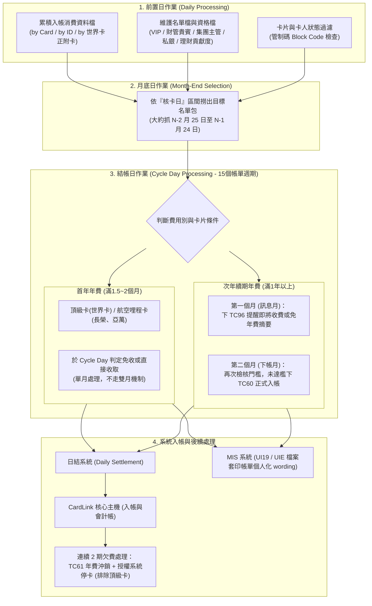
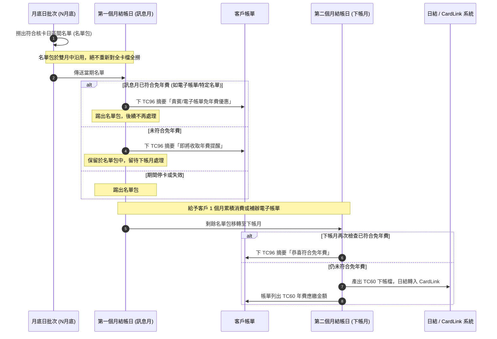
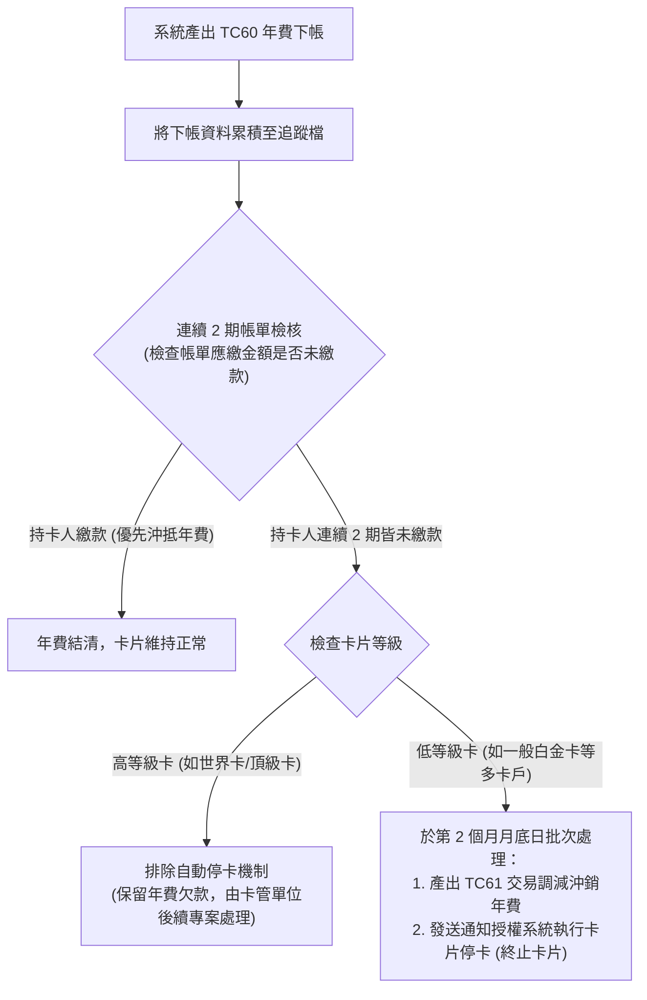

# 教育訓練知識筆記：信用卡年費作業與系統處理機制

> **課程主題**：信用卡年費作業流程、前後置批次架構、核心欄位與系統判定邏輯  
> **講師**：文華  
> **筆記類型**：教育訓練與知識傳承筆記（Scenario C）  
> **整理日期**：2026-10-30  

---

## 1. 本次課程摘要

本課程詳細說明信用卡核心系統中的**年費（Annual Fee）作業機制**。課程內容涵蓋年費的「日作業」、「月底日篩選作業」與「結帳日（Cycle Day）下帳作業」之三層架構，深入解析**首年年費**與**次年續期年費**的判定邏輯與時間點。此外，課程進一步拆解卡人檔與卡片檔的關鍵檢核欄位（如 VIP Code、User Code、管制碼 Block Code、Waive Flag 等）、帳單訊息代碼（TC96、TC60、TC61）與 MIS 帳單套印機制的串接，以及多卡欠繳年費之自動終止卡片（停卡）與沖帳優先順序等重要法規與實務內規。

---

## 2. 知識架構

---

## 3. 核心概念

### 概念 1：年費本質與預收原則
- **是什麼**：年費為持卡人持有特定信用卡所需支付的年度維護管理費用，每張卡片一年僅收取一次。
- **為什麼存在**：支應用戶權益維護成本（如頂級卡權益、高額保險、貴賓室及哩程成本）。
- **如何運作**：年費採「預收」制。以核卡日為基準，通常在核卡後約 1.5 到 2 個月左右開始準備下帳處理（例如 8 月核卡，約於 10 月結帳日入帳）。
- **實務限制**：年費屬於費用類科目，受信用卡帳務特性限制，**必須且只能在「結帳日（Cycle Day）」入帳**，不可於月中任意入帳。

### 概念 2：三層作業處理架構
年費作業並非單一排程，而是由三層批次作業緊密串接：
1. **日作業（Daily Job）**：每日營業日執行，負責累積消費數據（依卡片、依歸戶 ID、依世界卡正附卡）、更新資格檔（VIP 檔、名單檔）及維護卡片有效狀態。
2. **月底日篩選作業（Month-End Job）**：每個月最後一個營業日執行，依核卡月份區間（以核卡日為主）批次撈出即將進入年費處理期的卡片名單包。
3. **結帳日作業（Cycle Day Job）**：銀行共有 15 個結帳日。系統每日檢核當天是否為特定客戶之結帳日，並針對名單包內的客戶進行免年費門檻檢核與下帳處理。

### 概念 3：首年年費 vs. 續期（次年）年費機制
- **首年年費**：
  - 目前會收取首年年費的卡別僅 3 種：**世界卡**、**長榮航空聯名卡**、**亞洲萬里通聯名卡**。
  - 首年年費採「單月判定」，不執行雙月提醒，於核卡後 1.5~2 個月之結帳日直接判定是否符合免年費，若不符合則直接下帳。
- **續期年費（次年起）**：
  - 核卡滿 1 年以上之卡片適用。
  - 採「雙月作業機制」：提早 1 個月撈取資料並於結帳日下發 `TC96` 提醒訊息，給予持卡人 1 個月緩衝期補足消費門檻或申辦電子帳單；第 2 個月結帳日再次檢核，若仍未達檻始下 `TC60` 正式收費。

### 概念 4：TC 交易代碼機制
- **TC96（年費提示 / 免收摘要代碼）**：
  - 下至客戶帳單明細上，**金額為 0，不影響帳務平衡與應繳金額**。
  - 作為提醒用途：第一個月通知「即將收取年費，請留意門檻」；或第二個月告知「恭喜符合免年費優惠」。
- **TC60（年費正式下帳代碼）**：
  - 年費的標準交易代碼，直接記入客戶帳單本期應繳費用中，由日結系統轉入核心系統入帳。
- **TC61（年費調減 / 沖銷代碼）**：
  - 用於連續欠費停卡時沖銷掛在帳上的年費，或人工特殊減免時做日沖處理。

### 概念 5：沖帳順序與結帳日入帳之必然性
- **沖帳順序**：依信用卡約定條款，持卡人繳納之款項，其沖帳順序為**「費用優先沖抵」**（費用類優先於利息、本金）。只要客戶有消費並繳款，款項必定先沖抵年費，無法指定僅繳消費本金。
- **為何只能結帳日下帳**：若在月中隨意下帳年費，客戶在結帳日前繳納前期的消費帳款時，款項會被系統誤沖抵當期剛產生的年費，導致前期消費本金未結清而衍生違約金或計息爭議。因此所有費用一律限制在 Cycle Day 入帳。

### 概念 6：聯名卡換發 CUBE 卡未開卡免年費
- **背景**：早期年費規則不論持卡人是否開卡，只要合約有效且時間到期即進行年費判斷與下帳。
- **新增規則**：因近年好市多（Costco）與 SOGO 等聯名卡大量換發為 CUBE 卡，受限於換卡條款與法規要求，針對「聯名卡換發 CUBE 卡」之特定集團代碼，新增檢核條件：**若持卡人「未開卡」，系統一律不得收取年費**，並對應產出未開卡免年費之帳單訊息。

---

## 4. 重要流程

### 流程 1：續期年費雙月判定與入帳流程

### 流程 2：多卡戶連續欠繳年費自動停卡與沖銷流程

---

## 5. 系統／角色關係

| 系統／角色名稱 | 角色與定位 | 在年費作業中的核心職責 |
|---|---|---|
| **卡片檔與卡人檔 (Master Files)** | 核心主機基底資料 | 提供核卡日、卡片管制碼、卡人管制碼、VIP Code、User Code、Waive Flag、電子帳單註記等判定基礎。 |
| **年費批次模組 (Fee Batch Module)** | 業務運算核心 | 負責日累積、月底名單篩選、結帳日條件比對、門檻計算與雙月追蹤。 |
| **日結系統 (Daily Settlement)** | 帳務交換中樞 | 接收年費批次產出之入帳資料包，轉為標準會計分錄與入帳格式，送入 CardLink。 |
| **CardLink 系統** | 信用卡核心帳務主機 | 負責將交易記入卡片帳務（Posting），產出帳單科目與管理應收費用帳務。 |
| **MIS 系統** | 帳單訊息處理系統 | 接收年費批次產出之訊息檔（如 `UI19`、`UIE`），依「卡別 + 集團代碼」套印客製化帳單 wording。 |
| **授權系統 (Authorizer)** | 連線授權控管 | 接收批次欠費停卡指令，將卡片狀態變更為停卡無效，阻斷後續刷卡交易。 |
| **卡金部 / 卡管單位** | 業務管理單位 | 針對頂級卡長期呆卡、特殊積欠年費案件進行專案清查、整包調減與手動停卡。 |

---

## 6. 關鍵名詞與代碼表

### 關鍵名詞定義

| 名詞 | 英文／縮寫 | 說明 |
|---|---|---|
| **自發卡** | Banca 卡 | 銀行自行發行之卡片（與聯名卡相對），年費作業邏輯一致，僅減免門檻不同。 |
| **聯名卡** | Co-branded Card | 與特定企業或機構合作發行之卡片（逐字稿中曾誤音為雷明卡）。 |
| **結帳日** | Cycle Day | 客戶每月的帳單結帳日期。全行共設有 **15 個結帳日**，費用入帳必須在此日進行。 |
| **卡座核心系統** | CardLink | 銀行信用卡底層核心帳務系統（逐字稿音譯為他利可/開立ite）。 |
| **管制碼** | Block Code | 掛於卡片檔或卡人檔之控管代碼，代表卡片暫停使用、逾期、呆帳或停用狀態。 |
| **歸戶** | By ID / 規復 / 規步 | 以持卡人身分證號（ID）為維度進行額度、消費或年費規則整合判定。 |
| **挽留減免** | Negotiation (逆溝) | 客戶因年費進線客服要求剪卡時，客服人員爭取客戶留存而設定之年度減免註記。 |

### 核心代碼對照表

| 代碼類別 | 代碼名稱 | 代碼值／參數 | 業務意義與處理規則 |
|---|---|---|---|
| **交易代碼 (TC)** | TC96 | 訊息提示 | 帳單摘要代碼，金額為 0，不計入帳務應繳金額。用於提前提醒即將收費或提示免年費。 |
| | TC60 | 年費入帳 | 年費標準交易代碼，產生實質應繳帳款。 |
| | TC61 | 年費調減 | 年費沖銷代碼，用於欠費停卡沖回或手動調減。 |
| **卡人檔 (Cardholder)** | VIP Code | `1` | 卡人 VIP 等級為 1 者，一律免收年費（頂級卡除外）。 |
| | Acct Block Code | `A`、`B`、`D`、`G`、`E`、`GW` | 嚴重逾期、呆帳、催收或死亡管制碼。卡人檔掛此類碼者，名下所有卡片一律不處理年費（因已無法催收）。 |
| **卡片檔 (Card)** | User Code (Fee Code) | `0` | 終身免年費（不論任何條件皆不收取）。 |
| | | `1` | 首年免年費。 |
| | | `9` | 年費 5 折優惠。 |
| | | `2` / `3` | 特殊活動代碼（如前兩年免年費，較少使用）。 |
| | Waive Flag | `1` | 當年度免收年費註記。客服手動設定後有效，待該卡年度年費月份過後，系統批次自動 reset 為 `0`。 |
| | Card Block Code (有效卡) | 空白 或 `C, H, K, P, Q, R, T` | 視為正常有效卡，需依規判定年費。 |
| | | `E` | 過期碼，若 Expiry Date 超過 1 年仍視為有效卡。 |
| | | `Y` | 暫控卡。一般卡不收，但**頂級卡特別規定掛 Y 碼仍需收取年費**。 |
| **外圍介接檔** | UI19 | 提醒訊息檔 | 提供給 MIS 系統，套印 TC96 提醒收費帳單訊息。 |
| | UIE | 下帳訊息檔 | 提供給 MIS 系統，套印 TC60 正式收取年費帳單訊息。 |

---

## 7. 重要概念比較

### 1. 首年年費 vs. 續期（次年）年費

| 比較維度 | 首年年費 (First Year) | 續期年費 (Renewal Years) |
|---|---|---|
| **適用對象** | 核卡第一年之卡片（限世界卡、長榮航空、亞洲萬里通） | 核卡滿一年以上之所有有效卡片 |
| **作業時程** | 核卡後約 1.5 ~ 2 個月（如 8 月核卡，10 月結帳日處理） | 核卡年月滿一年後，提前 1 個月進行撈取 |
| **處理機制** | **單月直接判定**（於 Cycle Day 直接下帳或免收） | **雙月機制**（第 1 個月下 TC96 提醒，第 2 個月檢核下帳） |
| **緩衝期** | 無提醒緩衝期 | 提供 1 個月緩衝期供持卡人補足消費門檻或辦理電子帳單 |
| **名單處理** | 單批次送日結入帳 | 月底包在第 1 個月篩除免收/停卡者，第 2 個月僅針對剩餘名單重判 |

### 2. 一般卡 vs. 頂級卡（世界卡）年費規則

| 比較維度 | 一般卡片 (白金 / 鈦金 / 御璽等) | 頂級卡 (世界卡 / 極致無限卡) |
|---|---|---|
| **附卡收費原則** | 附卡一律**免收年費** | 正卡與附卡**皆需收費**（僅附卡第 1 張免收） |
| **首年年費** | 首年一律免收 | 首年**一律收取**（除極少數特殊身分外無減免條件） |
| **名單豁免權** | 適用 VIP Code=1、財管名單、私銀名單等免收 | 大多數 VIP、財管名單不適用豁免，一律需收取 |
| **暫控碼 (Y碼)** | 掛管制碼視為無效卡，不收取 | 特別規範掛 `Y` 碼（暫控）仍需收取年費 |
| **欠繳自動停卡** | 連續 2 期未繳且為多卡戶，系統自動 TC61 沖銷並停卡 | **排除在自動停卡機制之外**，不得自動沖銷停卡 |

### 3. 公開年費規則 vs. 內部規則（內規）

| 規則類型 | 規則範疇 | 範例說明 | 對外公開狀態 |
|---|---|---|---|
| **公開規則 (對外)** | 依產品公告之常態門檻 | • 申辦電子帳單免年費（如 CUBE 卡、蝦皮卡） • 年度消費金額或刷卡次數達標免年費 | 官網產品頁面公開公告 |
| **內部規則 (內規)** | 銀行內部風險與客群維繫機制 | • **高等級卡涵蓋歸戶**：持有世界卡，名下御璽/鈦金卡免收年費 • **特殊名單豁免**：VIP Code=1、財管貴賓、集團長官免收 • **白金卡防剪機制**：同月份核發兩張白金卡達下帳門檻時，內規剔除一張不下帳，避免客戶全數剪卡 • **Waive Flag 挽留**：客服設定 1 免收，年度過後自動清為 0 | **僅限內部系統執行，嚴禁對外公告** |

---

## 8. 講師案例與實務場景

### 案例 1：航空哩程卡與世界卡收費特例
- **世界卡**：首年與次年原則上無任何減免條件，一律下帳收取；僅有集團長官特殊名單可專案免收。
- **長榮航空聯名卡**：
  - 最低等級（白金卡）：首年免收年費，次年起才收取。
  - 高等級（極致無限卡等）：首年一律收取。但若持卡人具備「長榮航空員工」或「集團主管」身分，系統比對名單後不予收取。
- **亞洲萬里通聯名卡**：
  - 最低等級（白金卡）：首年免收年費。
  - 高等級：首年一律收取，無特殊主管豁免條件。

### 案例 2：客服進線挽留（Negotiation）處理
- **情境**：客戶收到帳單上的 TC96 提醒訊息或 TC60 年費帳單，致電客服揚言剪卡（停卡）。
- **處理機制**：客服人員評估客戶貢獻度後決定挽留，於系統卡片檔之 `Waive Flag` 欄位註記為 `1`。
- **系統反應**：當期年費予以減免；該註記會持續保留，直至該卡片之**年費月份過後，系統批次自動將其 Reset 為 0**，次年度恢復正常檢核。

### 案例 3：好市多 / SOGO 聯名卡換發 CUBE 卡之未開卡客群
- **情境**：因合約轉換，銀行主動換發 CUBE 卡給原聯名卡客戶，但客戶收到卡片後未開卡使用。
- **系統處理**：年費批次新增檢核 logic，若為該批換發之特定「卡別 + 集團代碼」，且卡片狀態為「未開卡」，則系統直接不收取年費，帳單同步產出免年費訊息，避免引發客訴與法規爭議。

---

## 9. 講師特別提醒（重要觀念）

> [!IMPORTANT]
> **結帳日（Cycle Day）才能下年費入帳**  
> 信用卡所有的繳款沖帳邏輯均為**「費用優先沖抵」**。若未在結帳日下帳而在月中任意入帳，持卡人在結帳日前繳納消費款時，會被系統優先沖抵年費，導致應繳消費款項出現缺口而產生滯納爭議。因此所有費用類別一律限制在 Cycle Day 當日入帳。

> [!IMPORTANT]
> **名單包不重新全撈原則**  
> 續期年費在月底日撈出當期名單包後，第 1 個月（訊息月）處理排除已符合免年費或已停卡之客戶；**留下來的剩餘名單，於第 2 個月（下帳月）直接在此名單包中二次檢核，絕不重新對全核心卡片檔全撈**。

> [!WARNING]
> **純年費欠繳不可視為「逾期戶」**  
> 主管機關嚴格規範：若持卡人帳單上**「僅有年費欠款而無任何消費款」**，銀行**不得將其列為逾期戶**，亦**不得向聯徵中心（JCIC）報送逾期、不得進行催收、不得下催收管制碼**。

> [!TIP]
> **費用優先沖抵對持卡人行為的制約**  
> 持卡人若想「只刷卡消費、只繳消費款而不繳年費」，在系統機制上是**不可行的**。因為繳款進入主機後一律先沖費用（年費），本金將因此短繳而產生逾期與循環息，因此持卡人只要有動用卡片，就必須繳納年費或主動向客服申請調減。

---

## 10. Q&A 整理

### Q1：持卡人帳上年費一直掛著未繳期間，還可以正常刷卡消費而不繳年費嗎？
**講師解答**：
不可以。這牽涉到信用卡約定條款中的「充帳（沖帳）順序」：
1. 持卡人繳納的任何款項，系統一律**優先充抵各項費用（年費、違約金、手續費等）**，餘額才能充抵利息與消費本金。
2. 持卡人繳款時**無法自行指定**只充抵本金而不充抵年費。
3. 因此，持卡人若繼續消費並繳款，繳款金額會自動被扣去繳年費，導致消費本金未繳清而衍生利息與違約問題。除非持卡人進線客服成功申請專案調減免收，否則只要有用卡就無法規避年費。

### Q2：年費下帳資料除了送交日結系統之外，是否還需要傳送到其他外圍系統或資料倉儲？
**講師解答**：
不需要另外傳送。因為年費資料傳送給日結系統後，日結會轉成標準入帳格式寫入 CardLink 核心系統。核心主機完成入帳（Posting）後，所有的交易明細與帳單資料本來就會完整保留於核心與帳單資料庫中，無需額外備份或傳送外部倉儲。

### Q3：帳上累積數年年費未繳的呆卡，是如何處理的？
**講師解答**：
1. **日常自動化處理**：僅針對多卡戶的低等級卡（如白金卡），連續 2 期欠繳年費者，第 2 個月月底自動由系統執行 TC61 沖銷並連線停卡。
2. **頂級卡與專案處理**：頂級卡（世界卡）排除在日常自動停卡之外。若帳上長期累積年費，後續由**信用卡管理單位（卡管部/卡品單位）進行不定期專案清理**，以批次作業整包執行停卡並整包調減沖銷年費。這屬於卡管單位的呆卡清理作業，非日常年費主批次系統之例行範疇。

---

## 11. 尚待釐清 / 待確認事項

1. **頂級卡附卡第 1 張免年費之實際上線生效時點**：講師提及「附卡不收年費要等頂級卡上線之後再備註一下，頂級卡正附都要收，只有第一張附卡不收」，其實際上線與系統參數生效時程待進一步確認。
2. **頂級卡暫控碼（Y 碼）之歷史系統邏輯**：逐字稿提及早期將 Y 碼當成特定控管碼，後續頂級卡特別要求掛 Y 碼亦需收取年費，其背後之業務原由講師表示為歷史沿革，待進一步確認是否持續沿用。

---

## 12. 補充知識

> [!NOTE]
> *以下內容並非原始逐字稿內容，而是補充說明，協助學習者理解銀行信用卡專業架構。*

1. **CardLink 核心系統背景**：CardLink 是亞太地區多家主流商業銀行（如國泰世華等）廣泛採用之信用卡核心帳務後台系統，負責卡人/卡片基本資料、帳務計息、費用下帳（TC Code）、授權限額與帳單產出。
2. **主管機關對年費欠款之規範依據**：金管會規定信用卡年費非屬實質信用擴張之消費款項，若持卡人未啟用卡片或僅積欠年費，發卡機構不得逕行報送聯徵中心信用不良紀錄，亦不得計收循環信用利息與違約金，以保障消費者權益。銀行實務上多以自動調減（TC61）合併停卡作為呆卡退場機制。
