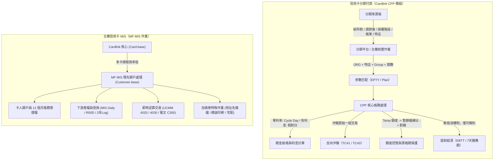
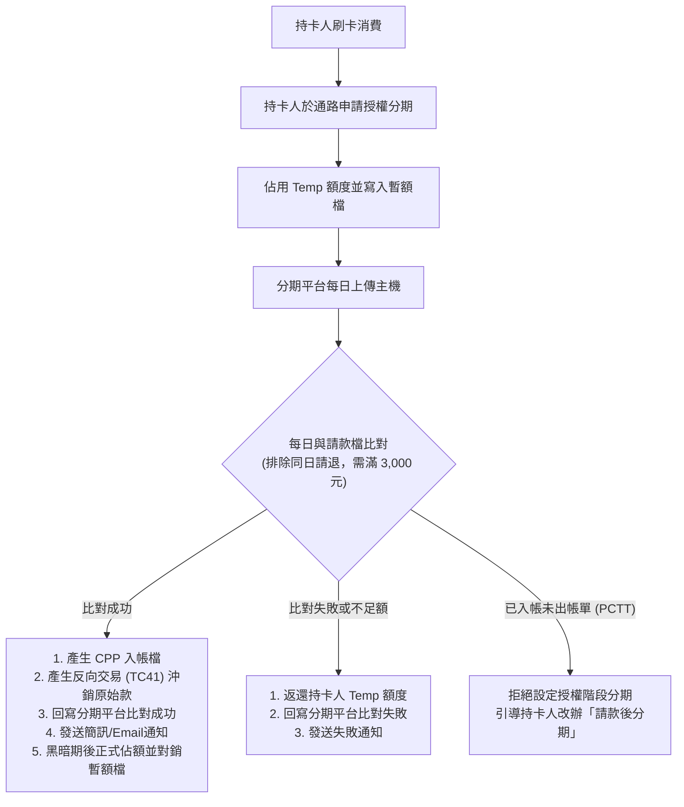
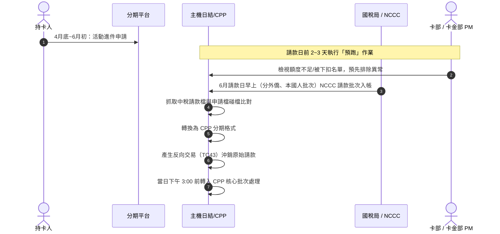
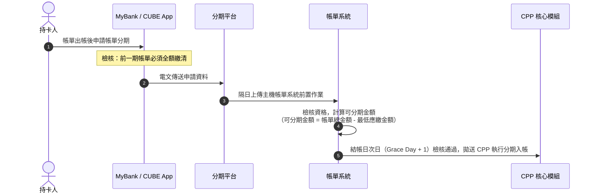
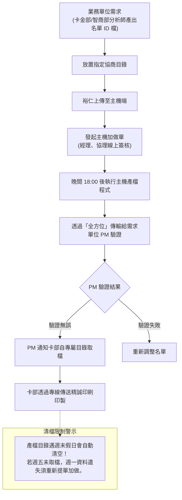
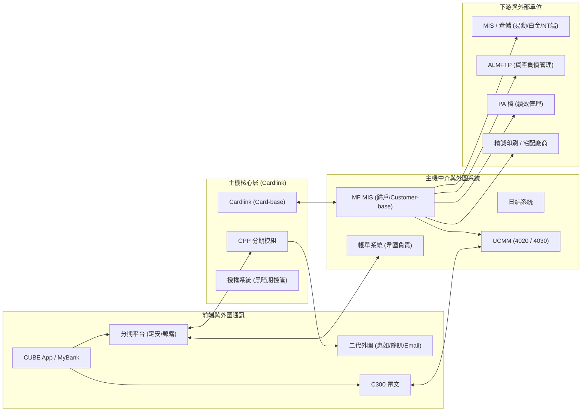

# 教育訓練知識筆記：信用卡分期付款模組（CPP）與主機信用卡 MIS（MF MIS）

> **授課講師**：裕仁  
> **筆記屬性**：教育訓練與技術傳承（Training / Knowledge Transfer）  
> **主要涵蓋領域**：Cardlink 主機信用卡分期模組（CPP）、主機信用卡 MIS（MF MIS）架構與作業流程

---

## 1. 本次課程摘要

本課程由主機資深同仁裕仁進行技術交接與知識傳承，系統性說明兩大核心領域：
1. **信用卡分期處理模組（Cardlink CPP）**：深入解析各類分期來源（綜所稅、請款後/樂分期、授權階段分期、NCCC/自然收單特店分期、帳單分期等）、分期參數設定（Plan、Group、Special Plan）、額度暫存與黑暗期防護機制、期金拋帳與沖銷交易（TC41/TC43）、以及提前結清（含樂分期 7 天猶豫期）與遇假日雙期期金之客訴實務。
2. **主機信用卡 MIS（MF MIS）與外圍架構**：說明為何在 Card-base（以卡為基礎）的 Cardlink 核心之外，必須建置 Customer-base（歸戶）的 MF MIS 作業；詳解歸戶管理檔、異動記錄檔（Daily Log）、評分與調額試算交易（UCMM 4020、4030 與線上電文 C300 同步邏輯），以及地址名條檔加做審核與清檔限制。

---

## 2. 知識架構

---

## 3. 核心概念

### 3.1 Cardlink CPP 模組
* **是什麼**：主機信用卡核心系統（Cardlink）內部的分期付款核心子模組（Cardlink Payment Plan / Installment Module）。
* **為什麼存在**：專門處理持卡人在額度內的消費款分期交易，負責利率計算、期金拋帳、額度控管與會計帳務。
* **運作限制**：CPP 處理的分期期數上限**最多不超過 30 期**；長天期（年期型）或信貸性質之「簡易貸款」屬於獨立系統，不在 CPP 範圍內。CPP 處理之交易前提必須是持卡人的「消費款交易」。

---

### 3.2 分期交易來源與業務邏輯

| 分期來源類型 | 申請時點與門檻 | 利率屬性 | 核心處理特點 |
| :--- | :--- | :--- | :--- |
| **綜合所得稅分期** | 每年 5~6 月申報季（4 月底活動上線，國稅局 6 月請款） | 視專案/卡別（如世界卡有零利率期數） | 金額龐大（曾有超過 10 億元之大戶）；請款日前 2~3 天需執行「預跑」檢查；分外僑與本國人兩批請款。 |
| **請款後分期（樂分期 / 刷樂分期）** | 刷卡請款入 Cardlink 核心後申請；最低門檻 **3,000 元** | 有利息 | 涵蓋樂分期、稅款/水電、各類保費分期；申請時先佔 Temp 額度，請款資料轉入 CPP 後正式扣額並對銷 Temp 額度。 |
| **授權階段分期（授權預約分期）** | 刷卡後、請款日前申請；最低門檻 **3,000 元** | 有利息 | 需與每日請款檔碰檔比對（完全比對或部分比對）；若已入帳未出帳單（PCTT）則不可設定，須改辦請款後分期。 |
| **NCCC 分期 / 自然收單分期** | 特約商店（如 SOGO 百貨）刷卡當下櫃台直接指定 | **零利率（不收利息）** | 透過 NCCC 聯卡中心或自行收單送入，直接拋給 CPP；Group 設為 `0000`，不收分期利息與手續費。 |
| **帳單分期** | 帳單產出後申請；**前一期帳單必須全額繳清** | 有利息 | 可分期金額需**扣除當期最低應繳金額**（如帳單 1 萬、最低應繳 1 千，可分期本金為 9 千）；由外圍帳單系統前置檢核後拋送。 |
| **郵購分期** | 特殊行銷合約簽署客戶 | 依合約 | 屬早期特殊業務模式，**目前主機已無新件進件**。 |

---

### 3.3 分期方案設定架構（EPTY、Plan、Group、Special Plan）
* **Plan（分期方案）**：定義分期期數（如 3、6、12 期）、適用利率、計息方式等底層參數。
* **EPTY**：CPP 模組內專門用來維護與設定 Plan 參數的交易功能。
* **Group（分期群組）**：由前端分期平台在進件時帶入主機，主機透過 `ORG（如 013） + 特店代號 + Group + 期數` 查找對應 Plan。
  * *案例*：以綜所稅為例，分一般客戶（Group 01）與世界卡客戶（Group 02），世界卡客戶可享有兩種零利率期數選擇。
  * NCCC 與自然收單分期因皆為零利率，其 Group 預設均為 `0000`。
* **Special Plan（特殊方案）**：
  * 當業務有特定促銷期間時啟用，具明確起訖「有效期間」。
  * 在有效期間內，Special Plan 設定會優先覆蓋一般 Plan；有效期間屆滿後，系統自動回歸一般 Plan，Special Plan 自動失效歸零。

---

### 3.4 額度控管與主機黑暗期防護機制
* **暫存佔額（Temp 額度）**：客戶申請樂分期或授權階段分期時，即時佔用 `Outstanding Installment Limit` 並寫入「暫額檔」，防止持卡人額度被其他交易挪用。
* **黑暗期（Dark Period）補佔額**：
  * 每日凌晨 2:00 ~ 3:00 為主機黑暗期，授權系統會排程清空所有 Outstanding 額度。
  * 因請款資料尚未正式入帳，為避免客戶額度在清空後被釋放而發生重複刷卡超額，系統在黑暗期利用「暫額檔」重新執行補佔額。
* **暫額對銷與還額**：
  * 次日分期平台資料轉入 CPP 並完成夜間批次後，系統產出對銷資料清除暫額檔。
  * 正式入帳後，每拋出一期期金，系統即自動返還該期所佔用之額度。

---

### 3.5 反向沖銷交易（TC41 / TC43）
* **為什麼存在**：授權階段分期與請款後分期進件時，Cardlink 主機已存在原始消費請款紀錄。
* **運作機制**：將金額轉入 CPP 分期帳務前，必須產生一筆反向交易（TC41 或 TC43）將原始款項沖銷，以避免分期金額與原始金額同時出現在帳單造成重複計費。

---

### 3.6 主機信用卡 MIS（MF MIS）架構定位
* **是什麼**：主機端專門針對信用卡資料進行預先歸戶整理與加值管理的中介作業。
* **為什麼存在（架構痛點）**：
  * 核心系統 Cardlink 是以「卡片（Card-base）」為存取基礎，未原生提供單一持卡人的整合歸戶視圖。
  * 外圍系統（日結、帳單、紅利、催收等）的業務規則均以「客戶身分證號（Customer / ID-base）」為基準。
  * 若各外圍系統各自對 Cardlink 進行掃描加總，主機效能將不堪負荷且邏輯混亂。因此由 MF MIS 在前置批次中統一進行「歸戶（Customer-base）」，產出歸戶管理檔供下游系統統一讀取。

---

### 3.7 評分與額度試算交易（UCMM 4020 / 4030 與 C300 電文）
* **UCMM 交易性質**：屬於外圍系統在主機上的交易介面（非 Cardlink 原生交易）。
* **UCMM 4020**：提供持卡人歸戶下「近 12 個月消費與帳單統計」（包含消費總額、預借現金、循環金額、循環率、繳款延滯等），主要提供給評分系統（Traite）進行風險評分與調額參數運算。
* **UCMM 4030**：提供業務單位查詢與試算持卡人「永久可調額度」與「臨時可調額度」。
  * 整合歸戶下最嚴重繳款評等、最嚴重 Block Code、最近停卡日（Cost Day）等。
  * 內建控管邏輯：若為「長期循環轉小額信貸」控卡客戶不予調整；若「近 6 個月內曾辦理永久調額」亦不允許調額。
  * **無歷史保留**：4030 僅為即時試算並即時顯示於終端畫面上，系統後台不留存試算歷史紀錄。
* **外圍電文 C300**：串接線上數位通路（如 CUBE App 即時線上調額），底層試算邏輯與 4030 完全一致。**講師強調：4030 規則變更時，C300 必須同步修改**。

---

## 4. 重要流程

### 4.1 授權階段分期比對與入帳流程

---

### 4.2 綜合所得稅分期處理流程

---

### 4.3 帳單分期處理流程

---

### 4.4 提前結清（提前解約）處理流程
1. **申請進件**：持卡人致電客服要求提前結清。
2. **通報與執行**：客服通知卡部，卡部透過主機交易代碼 `EBTT`（或 `EDTT`）執行人工提前結清。
3. **利息與本金計算**：
   * 系統將剩餘未到期之各期期金全數一次性拋出。
   * 後續未拋期之「分期利息」停止計算（不再計收）。
   * **本金入帳規則**：剩餘未到期本金將**全額計入下一期帳單之最低應繳款（Minimum Due）**。
4. **特殊分支（樂分期 7 天猶豫期）**：
   * 僅限「樂分期」產品享有 7 天猶豫期。
   * 若持卡人在申請 7 天內申請提前結清，系統將其轉回一般消費款處理，最低應繳金額依正常比例計算，不需全額計入最低應繳。

---

### 4.5 地址名條檔加做作業流程

---

## 5. 系統／角色關係

* **系統與對應負責角色**：
  * **主機分期與 MF MIS 維護**：裕仁（負責主機批次、加做單、CPP 核心帳務與名條轉檔）。
  * **分期平台**：定安端負責（管理前端通路進件與主機檔案拋接）。
  * **帳單系統**：外圍主機系統，由韋國負責（負責帳單分期前置檢核與計算）。
  * **二代外圍**：由惠如團隊負責（負責帳單列印、分期成功/失敗之簡訊與 Email 發送通知）。
  * **下游 MIS / 倉儲**：由易勳端負責（接收每日卡片異動 Log、R00D 查詢檔，保存 2 年以上歷史紀錄）。
  * **前端卡業務單位**：卡部、卡金部、智能商業部（智商部），負責分期活動規格、名單產出與取檔送印。
  * **金服 / 客服**：金服透過專屬電文執行人工分期；客服負責處理持卡人提前結清、客訴與爭議調解。

---

## 6. 關鍵名詞

| 名詞 | 英文／縮寫 | 說明 |
| :--- | :--- | :--- |
| **Cardlink 分期模組** | CPP (Cardlink Payment Plan) | Cardlink 核心內掌管信用卡消費分期、計息、拋帳及額度控管之主模組。 |
| **分期方案** | Plan | 定義分期期數、利率與計息參數之設定檔案。 |
| **分期群組** | Group | 由分期平台帶入主機的分類代碼，與特店、期數共同決定適用 Plan（如一般客與世界卡分組）。 |
| **參數設定交易** | EPTY | CPP 內部用以設定與維護 Plan 相關參數之主機交易代碼。 |
| **人工分期交易** | EBPT | 卡部於主機端執行的人工強制分期交易，只要額度充足即可承作（不受結帳日限制）。 |
| **人工提前結清交易** | EBTT / EDTT | 持卡人申請提前解約時，卡部用以將剩餘期金全數拋出結清之主機交易。 |
| **暫存分期額度** | Outstanding Installment Limit | 持卡人申請分期後、正式扣減額度前，系統預先凍結之臨時額度。 |
| **暫額檔** | - | 主機端建立之臨時佔額紀錄檔，用以防止主機黑暗期清理額度時造成客戶重複佔額。 |
| **主機黑暗期** | Dark Period | 每日凌晨 2:00 ~ 3:00 授權系統執行維護與額度清理之時段。 |
| **分期反向沖銷交易** | TC41 / TC43 | 授權或請款分期轉入 CPP 時，用以沖銷主機上原始一般消費之反向會計交易。 |
| **入帳未出帳單資料** | PCTT | 交易已向 Cardlink 請款入帳但尚未生成當期帳單之狀態資料。 |
| **同日請退** | - | 同一筆分期交易於同一天內同時進件請款與退貨，兩者互沖後直接以一般款項入帳，不執行分期。 |
| **七天猶豫期** | - | 樂分期專屬機制；申請後 7 天內結清視為一般消費，最低應繳金額依正常比例計算。 |
| **歸戶** | Customer-base / ID-base | 將單一客戶身分證號名下所有信用卡與帳務資訊彙整為單一主體之作業方式。 |
| **個卡** | Card-base | 核心系統 Cardlink 的原始設計方式，每一筆帳務均獨立綁定單一卡號。 |
| **凍結碼** | Block Code | 卡片狀態控管代碼（如 A Code 等嚴重度評級），歸戶管理檔會抓取客戶名下最嚴重等級。 |
| **最近停卡日** | Cost Day | 持卡人名下所有卡片中，最近一次發生停卡之日期。 |
| **即時調額電文** | C300 | 線上通路（如 CUBE App）呼叫之額度試算電文，底層邏輯與主機 4030 交易一致。 |
| **加做單** | - | 主機無常態每日批次之作業，需經業務主管、經理、協理核准後於夜間手動發起之批次申請。 |
| **全方位** | - | 銀行內部用以跨系統安全傳輸大型檔案之資料傳輸中介平台。 |
| **預跑** | - | （逐字稿音譯為浴袍）大型專案（如綜所稅）請款日前 2~3 天執行的模擬試算批次，以利預先排除異常。 |

---

## 7. 重要概念比較

### 7.1 人工分期途徑：卡部 EBPT vs 金服電文
| 比較維度 | 卡部主機交易（EBPT） | 金服專屬電文（模仿 EBPT） |
| :--- | :--- | :--- |
| **使用單位** | 卡部作業人員 | 第一線金服單位 |
| **設立背景** | 系統原生之主機人工分期交易 | 為分攤卡部大量人工進件作業負擔而新建 |
| **執行限制** | 只要持卡人分期額度足夠即可承作，**已過結帳日（Cycle）亦可執行** | **必須在主機看得到原始交易**才可承作；一旦過結帳日（過 Cycle）即無法執行 |
| **入帳交易** | 產生 TC43 轉出款沖銷 | 產生 TC43 轉出款沖銷 |

---

### 7.2 分期拋帳邏輯：零利率 vs 有息分期
| 比較維度 | 零利率分期（NCCC / 自然收單特店分期） | 有息分期（樂分期 / 帳單分期 / 授權分期 / 綜所稅） |
| :--- | :--- | :--- |
| **利息費用** | 免收分期利息與手續費（特店合約約定） | 依 Plan 設定按期計收分期利息 |
| **Group 代碼** | 固定為 `0000` | 依客群與專案指定（如一般客、世界卡等） |
| **首期拋帳時點** | 以持卡人最近之**結帳日（Cycle Day）**拋帳 | 依轉入 CPP 的**相對日**（滿一個月）拋帳 |
| **次期以後拋帳** | 固定於每期結帳日（Cycle Day）拋帳 | 依相對日拋帳，**若遇假日則延後至下一營業日** |

---

### 7.3 資料架構：Cardlink（Card-base）vs MF MIS（Customer-base）
| 比較維度 | Cardlink 核心系統 | 主機 MF MIS 作業 |
| :--- | :--- | :--- |
| **基底設計** | 以**卡（Card-base）**為基準 | 以**人／歸戶（Customer / ID-base）**為基準 |
| **資料組織** | 每張卡片獨立記錄交易、額度、Block Code | 撈取同一人所有卡片進行運算，抓出最嚴重狀態 |
| **主要功能** | 即時授權、帳務明細入帳、核心交易記帳 | 彙整 12 個月帳單、評分參數計算、下游系統供檔 |
| **外圍介接效率** | 外圍若直接存取，每次皆需自行全表掃描歸戶（效率極差） | 提供預先整合之歸戶檔，外圍系統可直接讀取單一視圖 |

---

### 7.4 額度試算：主機 UCMM 4030 vs 線上電文 C300
| 比較維度 | 主機交易 UCMM 4030 | 外圍電文 C300 |
| :--- | :--- | :--- |
| **操作介面** | 主機終端機綠界畫面 | 串接前端通路（如 CUBE App 線上調額） |
| **運算邏輯** | 永久／臨時可調額度試算（含控卡、半年內不可調等規則） | 與 4030 完全相同（共用相同計算核心） |
| **資料留存** | **僅於畫面上即時運算呈現，後台不落地留存歷史資料** | 線上流程即時回傳，若確認調額則直接生效更新主機 |
| **維護要求** | 業務邏輯修改時，兩者**必須同步修改** | 業務邏輯修改時，兩者**必須同步修改** |

---

### 7.5 提前解約：一般提前結清 vs 樂分期 7 天猶豫期
| 比較維度 | 一般提前結清（提前解約） | 樂分期 7 天猶豫期提前結清 |
| :--- | :--- | :--- |
| **適用對象** | 所有分期產品（已超過猶豫期或一般專案） | 僅適用於「樂分期」產品，且於申請 **7 天內**提出 |
| **未到期利息** | 後續未拋期數之分期利息停止計收 | 不計收分期利息 |
| **剩餘本金入帳** | **全額一次性計入下期最低應繳款（Minimum Due）** | **視為一般消費款入帳，按正常比例計入最低應繳** |
| **持卡人負擔** | 當期繳款壓力極大，若未全繳將產生循環利息 | 繳款壓力小，符合常態消費還款模式 |

---

## 8. 講師案例

1. **綜所稅百億大戶案例**：
   * 綜所稅分期額度通常極為龐大，講師指出曾有**單一頂級客戶申請超過 10 億元**的分期交易。
   * 因金額龐大，若批次失敗或額度不足將產生重大營運風險，故每年 6 月請款日前 2~3 天均必須執行「預跑」作業，由卡部/卡金部 PM 提前清查額度不足或卡片遭管制（下扣）名單。
2. **綜所稅客戶分群案例**：
   * 系統透過 Group 代碼區隔權益。以某年綜所稅為例，系統分為一般客戶（Group 01）與世界卡客戶（Group 02）；世界卡客戶進件時，系統判斷其卡別後套用 Group 02，提供專屬的兩種零利率期數方案供客戶選擇。
3. **帳單分期可分期金額計算案例**：
   * 客戶當期帳單總金額為 10,000 元，其當期最低應繳金額為 1,000 元。
   * 客戶申請帳單分期時，分期本金並非 10,000 元，而必須扣除最低應繳 1,000 元，故最終送入 CPP 的**可分期總金額為 9,000 元**。
4. **遇假日雙期期金與 Waive 利息客訴案例**：
   * 因假日主機不跑批次，期金拋帳若遇假日會遞延至下一營業日；然而部分客戶帳單結帳日遇假日可能提前計算，導致持卡人當月帳單「同時出現兩期期金」，引發客戶抗議。
   * **處理實務**：因批次架構限制此問題無解，客服通常採個案安撫，以人工入帳方式 **Waive（免收）因該筆期金提前入帳所產生的「應收利息」**（強調：Waive 的是應收利息而非分期利息本體）；極少數極度爭議案件才透過人工手動將期金往後遞延。
5. **歸戶最嚴重 Block Code 案例**：
   * 單一持卡人名下若有 3 張卡片，其中兩張正常無代碼（空白 `000`），但有一張卡片被壓上嚴重的 `A Code`。
   * MF MIS 進行歸戶處理時，會自動比對出權重最高、最嚴重的 `A Code` 寫入歸戶管理檔，外圍系統在進行風險審查時便能立即識別該客戶為高風險戶。
6. **名條檔案假日自動清空遺失案例**：
   * 裕仁於週五晚間加做產出地址名條檔並放置於主機目錄。若需求單位 PM 週五晚上未驗證或卡部未及時取檔，該目錄**經過週末假日會觸發自動清理機制而清空**。
   * 週一業務單位反映檔案消失時，唯一的解決方式是裕仁重新跑一次主管簽核加做單，再次夜間產檔。

---

## 9. 講師特別提醒

> [!WARNING]
> **交易進入 CPP 後絕對無法「取消」，僅能走「提前結清」**
> 持卡人若在分期平台暫存期間（尚未上傳主機前）皆可取消。但一旦交易正式轉入 CPP 核心模組，系統底層**沒有取消交易的功能，唯一的退場路徑就是「提前結清（EBTT）」**。

> [!IMPORTANT]
> **提前結清剩餘本金將「全額列入最低應繳」**
> 辦理提前結清時，剩餘未到期本金會一次性全數拋出並直接納入下期最低應繳款。若客戶無力一次繳清，將導致後續產生循環利息或逾期，第一線人員處理時須特別留意客戶說明。

> [!IMPORTANT]
> **主機黑暗期清額度的系統陷阱**
> 每日凌晨 2:00~3:00 主機黑暗期會清空授權端的 Outstanding 額度。若沒有靠主機自建的「暫額檔」即時補佔額，持卡人的額度在清晨將呈現釋放狀態，極易造成持卡人超額刷卡或重複佔額風險。

> [!CAUTION]
> **授權階段分期不可設定於 PCTT（已入帳未出帳單）**
> 授權階段分期限定於「已刷卡、尚未請款入帳」之間申請。若請款檔已進 Cardlink（即進入 PCTT 狀態），授權階段分期比對將直接擋下，必須引導客戶改辦「請款後分期」。

> [!NOTE]
> **4030 與 C300 必須維持雙軌同步**
> 主機端 4030 交易與線上電文 C300 邏輯完全一致。未來若業務單位提出調額試算規則調整（如調整年限、排除條件），工程師修改 4030 邏輯時**務必同步更新 C300**，否則線上與臨櫃試算將產生分歧。

> [!TIP]
> **地址名條作業之時效與清檔特性**
> 產檔目錄過假日會自動刪除檔案。產檔當日須緊盯 PM 驗證進度並確認卡部已專線送交精誠印刷，避免跨週檔案被清空導致重新加做延宕工時。

---

## 10. Q&A

**Q1：如果持卡人刷卡且辦理分期後發生退貨，主機帳務已下或未下該如何處理？**  
* **裕仁回答**：主要發生在請款後分期與授權階段分期。若交易尚未轉入 CPP，可直接在分期平台取消或互沖；但若**已經正式轉入 CPP，系統無法直接取消，唯一的處理方式是走「提前結清」**。退貨款進來後勾稽不到阻擋資料時，會產出報表由卡部人工辨識處理。

**Q2：為什麼 NCCC 與自然收單特店分期不收利息？目前業務主力是什麼？**  
* **裕仁回答**：特店分期零利率是當初行銷為了鼓勵持卡人刷卡，由業務單位（PM）與特店（如百貨）簽訂合約決定的合作模式。早期曾收過手續費但很久以前已取消。目前行內業務推廣的主力均放在有收取分期利息的產品（如樂分期、帳單分期等）。

**Q3：特店請款前，持卡人送出的分期申請是否可以取消？**  
* **裕仁回答**：在資料尚未正式轉入 CPP 之前都可以取消。例如請款後分期或授權分期，申請後資料會先停留在分期平台（定安端），在隔日或隔兩日批次上傳 CPP 之前，持卡人通知客服均可取消。但只要上傳入 CPP 後，就不能取消，只能走提前結清。

**Q4：分期成功與失敗的簡訊、Email 是由二代外圍哪位同仁負責串接？**  
* **裕仁回答**：主要對應窗口是二代外圍的惠如團隊（負責帳單列印相關作業），再由其系統串接別如航特等周邊通道進行發送。

**Q5：綜所稅分期一年分兩批請款的由來為何？近兩年有何變化？**  
* **裕仁回答**：一年固定兩批請款，傳統上第一天是「外僑」、第二天是「本國人」。過去通常是連續兩天請款，但近兩年國稅局作業間隔常拉開 2~3 天。若遇到重大事件（如先前疫情嚴重時報稅延期），主機批次也必須手動配合往後調移。

**Q6：特店 Group 與 Plan 的對應關係為何？利率設定在哪裡？**  
* **裕仁回答**：Group 是由分期平台帶入主機的分類代碼。主機透過 `ORG (013) + 特店代號 + Group + 期數` 帶出對應的 Plan。**利率是設定在 Plan 裡面**，Group 本身只負責對應，不直接包含利率數值。

**Q7：遇假日導致同月帳單出現兩期期金時，客服 Waive 的是哪種利息？**  
* **裕仁回答**：因假日批次遞延導致雙期期金時，客服為安撫客戶通常會辦理人工 Waive。但強調 **Waive 掉的是因為這筆期金多下而額外產生的「應收利息」（應計循環利息/費用），而不是直接免收分期原本的「分期利息」**。

**Q8：帳單系統是核心還是外圍？帳單分期的資料流向為何？**  
* **裕仁回答**：帳單系統屬於主機外圍系統（由韋國負責）。客戶從 MyBank 或 CUBE App 申請帳單分期後，電文先存入分期平台，次日上傳主機帳單系統進行前置資格判斷（排除未全額繳清者）並扣除最低應繳計算可分期金額。通過後於結帳日次日（Grace Day + 1）正式拋給 CPP 模組執行。

**Q9：為什麼主機需要另外建置 MF MIS？與一般 MIS 有何不同？**  
* **裕仁回答**：一般 MIS 是全行層級（匯總存匯、消金等各類資料）。主機 MF MIS 則是專門針對「信用卡」資料建置。因為核心 Cardlink 是 Card-base，外圍日結、帳單、紅利若各自撈卡片做歸戶會嚴重消耗主機效能。MF MIS 預先將同一人名下的卡片彙整為 Customer-base（歸戶），產出歸戶管理檔供各外圍系統直接使用。

**Q10：UCMM 4030 調額試算與 C300 電文有何關聯？試算結果會留存嗎？**  
* **裕仁回答**：兩者運算邏輯完全一致，C300 係提供前端（如 CUBE App）線上即時調額使用。4030 與 C300 試算出的可調額度**僅即時顯現在畫面上，後台完全不留存試算歷史紀錄**。若後續規則調整，兩支程式必須同步修改。

---

## 11. 尚待釐清

1. **綜所稅請款批次間隔原因**：近兩年國稅局外僑與本國人請款日程由連續兩天拉開為間隔 2~3 天，講師表示實際業務考量不清楚（推測可能為國稅局分散資料量）。
2. **宅配名條作業自動化取代進度**：講師提及行內後續有建置自動化系統以取代人工下傳宅配名條之作業，但目前新系統是否已 100% 取代、或仍有偶發手動下檔需求，現況尚待業務單位確認。

---

## 12. 補充知識

> [!NOTE]
> 本筆記內容完全依據原始逐字稿中講師裕仁之解說整理，嚴格遵守真實性原則，未額外杜撰非逐字稿提及之規格。各項交易代碼（如 EBPT、EBTT、TC41、TC43、4020、4030、C300 等）於實務修改前，請務必參閱主機最新規格書與程式原始碼。
